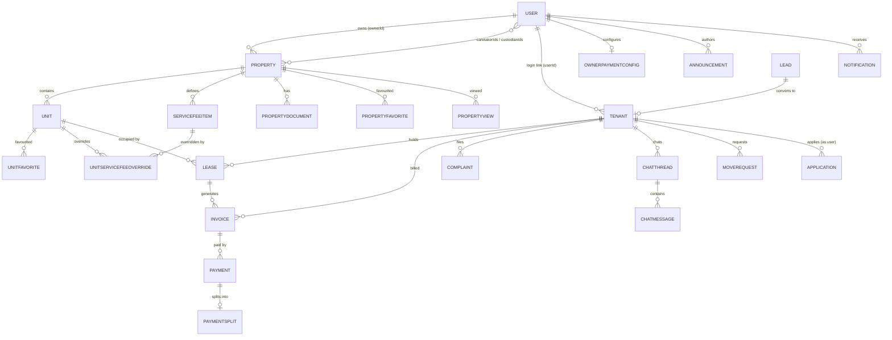

# Keja Yangu — Project Structure & Entity Map

This document is the high-level map of the codebase: what lives where, what each
entity is responsible for, and how the entities relate. It is intended for new
contributors and for anyone changing a cross-entity flow (applications →
allocation → leases → invoices → payments → notifications).

- **Product:** Kenyan rental/property management platform.
- **Stack:** Next.js 16 App Router, React 19, TypeScript (strict), Tailwind 4,
  shadcn/ui + Radix, Mongoose 9 / MongoDB, Zod 4 + react-hook-form,
  Vitest + Testing Library, Biome.
- **Runtime:** one Next.js app serving both the public site, role dashboards,
  and the REST API under `/api/v1`.

> Before using unfamiliar Next.js 16 APIs, read the matching guide in
> `node_modules/next/dist/docs/` — App Router conventions differ from older Next
> versions. This repo uses `src/proxy.ts` (the Next 16 replacement for
> `middleware.ts`) for the edge gate.

---

## 1. System overview

```
Browser (public site + dashboards)
        │
        │  HTTP / cookies (keja-token JWT)
        ▼
Next.js App Router
  ├─ src/app/(public pages, auth, dashboards)
  ├─ src/app/api/v1/**  (REST route handlers)
  └─ src/proxy.ts       (route gate for /dashboard and /api)
        │
        ├─ lib/permissions.ts  (JWT verification + RBAC guards)
        ├─ lib/* domain services (allocation, invoicing, payments, notifications)
        └─ models/* Mongoose schemas
                 │
                 ▼
              MongoDB
```

External integrations:

| Integration | Usage | Config |
| --- | --- | --- |
| Paystack | Platform-wide card/bank checkout, webhook | `PAYSTACK_SECRET_KEY`, `PAYSTACK_PUBLIC_KEY` |
| Safaricom Daraja (M-Pesa) | Per-owner STK push + callback | `OwnerPaymentConfig` row (encrypted secrets) |
| Nodemailer | Verification, password reset, invite, notification email | `EMAIL_*` |
| UploadThing | Property image uploads | `UPLOADTHING_TOKEN` |
| MongoDB | All persistent state | `MONGODB_URI` |

---

## 2. Repository layout

```
.
├── docs/
│   ├── PROJECT_STRUCTURE.md        ← this file
│   ├── plans/                      design intent for features (read before large changes)
│   └── superpowers/plans/          historical implementation plans
├── scripts/                        one-off backfills / migrations (tsx)
├── public/                         static assets
├── src/
│   ├── app/
│   │   ├── page.tsx                landing page
│   │   ├── properties/             public property listing + detail
│   │   ├── auth/                   sign in/up, verify, forgot/reset password
│   │   ├── dashboard/
│   │   │   ├── layout.tsx          client role gate (AuthGuard)
│   │   │   ├── owner/
│   │   │   ├── custodian/
│   │   │   ├── caretaker/
│   │   │   ├── tenant/
│   │   │   └── system-admin/
│   │   └── api/
│   │       ├── auth/               session actions + /me + /logout
│   │       ├── uploadthing/        UploadThing handler
│   │       └── v1/                 versioned REST API
│   ├── components/                 feature components + shadcn/ui primitives
│   ├── config/dashboardNav.ts      per-role navigation
│   ├── data/                       demo/seed fixtures (not the live data source)
│   ├── hooks/                      client data-fetching/mutation hooks
│   ├── lib/                        domain logic, guards, schemas, integrations
│   ├── models/                     Mongoose schemas
│   ├── test/                       Vitest setup + factories/model mocks
│   ├── types/                      shared client-facing serialized types
│   └── proxy.ts                    Next 16 route proxy (auth gate)
├── next.config.ts                  CSP/security headers, redirects, image config
├── biome.json                      formatting/lint rules
├── vitest.config.ts                jsdom + setup
├── Dockerfile / docker-compose.yml self-hosted deployment
└── .github/workflows/ci.yml        check → typecheck → build → test:coverage
```

### 2.1 `src/app/api/v1` route groups

| Group | Responsibility |
| --- | --- |
| `properties`, `units`, `property-types` | Portfolio structure and taxonomy |
| `properties/[id]/structure`, `service-fees` | Structure reconciliation, itemized service fees |
| `applications` | Prospect applies; approval admits a tenant and allocates a unit |
| `tenants`, `tenants/[id]/assignment` | Tenant records and unit assign/vacate |
| `leases` | Lease lifecycle |
| `invoices`, `invoices/generate` | Billing, generation, mark-paid, void |
| `payments/*`, `tenant/me/*` | Online checkout, webhooks, verify fallback |
| `move-requests` | Move-in / move-out approvals |
| `leads` | Prospect/lead pipeline |
| `chat`, `complaints`, `announcements`, `documents` | Communications |
| `notifications`, `settings`, `users/me` | Inbox and preferences |
| `favourites`, `properties/[id]/view`, `properties/recently-viewed` | Discovery and saved listings |
| `search`, `amounts` | Dashboard search and money rollups |
| `recycle-bin` | Restore/purge soft-deleted records (system-admin) |

---

## 3. Entity catalogue

Mongoose models live in `src/models/*.ts`. Collections use Mongoose's default
pluralized names. Soft delete is opt-in per model via
`softDeletePlugin` (`src/lib/mongoose-soft-delete.ts`).

### 3.1 Identity & access

#### `User` — `users`

The account and authentication identity for every role.

- **Key fields:** `email?`, `name`, `passwordHash`, `role`
  (`tenant | caretaker | custodian | owner | system-admin`), `privileges[]`,
  `managedByOwnerId`, `isActive`, `isVerified`, `phone`, `whatsapp`,
  `nationalId`, `verificationToken(+Expiry)`, `invoiceCounters`,
  `settings{emailNotifications, smsNotifications, marketingEmails,
  moderationReminders, language, theme}`.
- **Relationships:** `_id` is used as `ownerId` on properties, leases, invoices,
  payments, announcements, documents, service fees, etc. `_id` is used as
  `caretakerIds` / `custodianIds` on `Property`, `requestedById` on
  `MoveRequest`, `agentUserId` / `senderUserId` on chat, and `recipientUserId`
  on notifications.
- **Self-relations:** caretaker/custodian accounts carry `managedByOwnerId`
  pointing at their owner's `User._id`. `privileges` is only meaningful for
  caretakers (and the single `assign_privileges` token for custodians).
- **Indexes:** unique sparse `email`; unique partial `phone` (non-empty).
- **Security:** `nationalId` is stored encrypted (`enc:v1:…`, AES-256-GCM) via
  `lib/crypto.ts`; never log it. `passwordHash` is bcrypt.

#### `PropertyType` — `propertytypes`

Platform-wide, admin-managed taxonomy. Soft-deleted.

- **Key fields:** `key` (stable slug), `label`, `order`, `active`, `deletedAt`.
- **Relationship:** `Property.type` stores the `key` as a plain string, not an
  ObjectId. Renaming a type only changes `label`; `key` is reused by history.
- **Indexes:** unique partial `key` among live records.

#### `OwnerPaymentConfig` — `ownerpaymentconfigs`

One row per owner, holding M-Pesa (Daraja) credentials and the owner's on/off
switch.

- **Key fields:** `ownerId` (unique, `User._id`), `darajaEnabled`,
  `daraja{environment, consumerKey, consumerSecret, passphrase, shortcode}`.
- **Relationship:** 1:1 with an owner `User`.
- **Security:** three secret fields are encrypted at rest; the settings API only
  exposes "configured" booleans. Paystack is platform-wide env config, not here.

### 3.2 Portfolio structure

#### `Property` — `properties`

A building/property unit of inventory owned by one owner.

- **Key fields:** `title`, `type` (PropertyType key), `location`, `price`,
  `description`, `images[]`, `amenities[]`, `status`
  (`available | occupied | maintenance`), `ownerId`, `caretakerIds[]`,
  `custodianIds[]`, `createdById`, `beds`, `baths`, `area`, `published`,
  `dateCompleted`, `purpose`, `blocks[]`, `deletedAt`.
- **Embedded hierarchy:** `blocks[]` is an array of subdocuments;
  each block embeds `floors[]`. Both carry stable subdocument `_id`s.
  `floors[]` also carry `unitsPerFloor`, optional `rentOverride` and `purpose`.
- **Relationships:** 1:N `Unit` (`Unit.propertyId`); 1:N `Tenant`,
  `Lease`, `Invoice`, `ServiceFeeItem`, `PropertyDocument`,
  `PropertyFavorite`, `UnitFavorite`, `PropertyView`; owner and staff are
  `User` references.
- **Deletion:** soft delete. Deleting a property soft-deletes all its units and
  is refused while any `Tenant` still references it. Restoring/purging in the
  recycle bin applies the inverse cascade to units.
- **Public reads** project away `ownerId`, `caretakerIds`, `custodianIds`,
  `createdById`, `__v`.

#### `Unit` — `units`

The rentable unit within a block/floor. Materialized from the property
structure; not embedded.

- **Key fields:** `propertyId`, `ownerId`, `blockId`, `blockName`, `floorId`,
  `floorLevel`, `floorLabel`, `name` (e.g. `GA`, `3A`), `letter`, `status`
  (`available | occupied | maintenance`), `statusChangedAt`, `purpose`,
  `rent`, `serviceCharge`, `rentIncludesServiceCharge`,
  `rentSharePercent`, `serviceChargeSharePercent`, `beds`, `baths`, `area`,
  `tenantId[]`, `deletedAt`.
- **Relationships:** N:1 `Property`; `blockId`/`floorId` point at the embedded
  `Property.blocks[]._id` / `.floors[]._id`. `tenantId` is an **array of
  occupant `User._id`s**, not `Tenant._id`s. 1:N `Lease`, `Complaint`,
  `MoveRequest`, `UnitFavorite`, `UnitServiceFeeOverride`.
- **Naming:** generated as floor prefix + letter (`3A`, `GA`); a unit name is
  unique per block among live units. Validators enforce that inclusive-rent
  share percentages sum to 100.
- **Occupancy:** `Lease.unitId` is authoritative; `Unit.tenantId`/`status` are a
  cache written only by `lib/allocation.ts`.

#### `ServiceFeeItem` — `servicefeeitems`

Reusable monthly fee template on a property (water, security, garbage, …).

- **Key fields:** `ownerId`, `propertyId`, `label`, `amount`, `active`,
  `sortOrder`, `appliesTo` (`all | selected`), `unitIds[]` (when `selected`).
- **Relationships:** N:1 `Property`; referenced by
  `UnitServiceFeeOverride.itemId`.

#### `UnitServiceFeeOverride` — `unitservicefeeoverrides`

Per-unit deviation from the property's fee template.

- **Key fields:** `ownerId`, `propertyId`, `itemId`, `unitId`, `amount?`,
  `active?`.
- **Relationships:** `itemId` → `ServiceFeeItem._id`; `unitId` → `Unit._id`;
  unique per `(itemId, unitId)`.
- **Resolution order:** template item → override amount/active flag →
  legacy flat `Unit.serviceCharge` when no item applies. `lib/service-fees.ts`
  is the single resolver.

### 3.3 Tenancy & leasing

#### `Tenant` — `tenants`

A tenant/prospect membership of a property. Distinct from the login account.

- **Key fields:** `name`, `email?`, `phone?`, `propertyId`, `ownerId`,
  `type` (`residential | commercial | owning`), `status`
  (`active | pending | rejected`), `userId?`, `joinedAt`, `notes`, `deletedAt`.
- **Relationships:** N:1 `Property`; N:1 owner `User` (`ownerId`); optional 1:1
  login `User` (`userId`). `_id` is used as `tenantId` on `Lease`, `Invoice`,
  `Complaint`, `ChatThread`, `MoveRequest`, and `PropertyDocument`.
- **Linking:** `userId` may be empty for an invited/unregistered tenant. Signup,
  sign-in and verify-email heal unbound rows by matching normalised email or
  phone. Allocation refuses a tenant with no linked active account.
- **Uniqueness:** email/phone unique per property among live rows.
- **Billing:** `type: "owning"` tenants are skipped by invoice generation.

#### `Lease` — `leases`

The billing contract tying a tenant to a property and unit.

- **Key fields:** `tenantId` (`Tenant._id`), `propertyId`, `ownerId`,
  `unitId`, `rentAmount`, `frequency: "monthly"`, `startDate`, `endDate?`,
  `status` (`active | ended`), `notes`, `deletedAt`.
- **Relationships:** N:1 `Tenant`, `Property`, owner `User`; N:1 `Unit`
  (`unitId`, authoritative occupancy pointer); 1:N `Invoice` (`leaseId`).
- **Rules:** at most one active lease per tenant among live rows. Ending a
  lease stamps `endDate`.

#### `Application` — `applications`

A prospective tenant's application to a published property/unit.

- **Key fields:** `propertyId`, `unitId` (empty = property-level), `ownerId`,
  `applicantUserId` (`User._id`), `applicantName`, `applicantEmail`, `message`,
  `status` (`pending | approved | rejected`), `decidedById`, `decisionNote`,
  `decidedAt`, `deletedAt`.
- **Relationships:** N:1 `Property`, `Unit` (optional), owner `User`,
  applicant `User`.
- **Rules:** only tenants may apply; at most one live pending application per
  applicant per property. Approval creates/binds a `Tenant`, then allocates the
  requested unit and opens the lease. Rejection does not allocate. Only a
  pending application can be withdrawn (soft delete).

#### `MoveRequest` — `moverequests`

A move-in or move-out request that changes occupancy on approval.

- **Key fields:** `type` (`move-in | move-out`), `propertyId`, `ownerId`,
  `blockId`, `unitId`, `tenantId`, `requestedById`, `requestedByRole`,
  `requestedFor`, `requestedDate`, `note`, `status`
  (`pending | approved | rejected | cancelled`), `decidedById`,
  `decisionNote`, `decidedAt`.
- **Relationships:** `tenantId` → `Tenant._id` (move-in/out subject);
  `requestedById` → `User._id`; `unitId` → `Unit._id`.
- **Rules:** approval of a move-in calls `allocateUnit`; approval of a move-out
  calls `vacateUnit`. Effects run before the decision is persisted, so a failed
  allocation leaves the request pending.

#### `Lead` — `leads`

A lightweight prospect with no login account.

- **Key fields:** `name`, `phone`, `email`, `propertyId?`, `unitId?`, `ownerId`,
  `status` (`new | contacted | approved | rejected | converted`), `source`,
  `notes`, `createdBy`, `convertedAt`, `convertedTenantId`, `deletedAt`.
- **Relationships:** owned by an owner `User`; optional property/unit;
  conversion creates a `Tenant` and stores `convertedTenantId`.
- **Lifecycle:** `new → contacted → approved|rejected`; `approved → converted`.
  Conversion does not create a login account.

### 3.4 Billing & payments

#### `Invoice` — `invoices`

A monthly (or manual) rent invoice.

- **Key fields:** `invoiceNumber` (`INV-YYYYMM-NNNN`), `tenantId`
  (`Tenant._id`), `propertyId`, `leaseId` (empty for manual invoices),
  `ownerId`, `period` (`YYYY-MM`), `amountDue`, `amountPaid`, `status`
  (`draft | pending | paid | void`), `dueDate`, `issuedAt`, `paidAt`, `method`,
  `notes`, `paymentReference`, `paymentDescription`, `paidBy`, `paidByRole`,
  `rentAmount`, `serviceChargeAmount`, `rentIncludesServiceCharge`,
  `serviceFeeItems[]`, `deletedAt`.
- **Relationships:** N:1 `Tenant`, `Property`, owner `User`, `Lease`;
  1:N `Payment` (`invoiceId`); 1:1/1:N `PaymentSplit`.
- **Derived status:** `overdue` is computed at read time when a stored
  `pending` invoice is past `dueDate`; it is never persisted.
- **Rules:** invoice number unique among live rows; one live invoice per
  `(leaseId, period)` (manual invoices have no `leaseId`); due on the 5th of the
  following month.
- **Service-fee snapshot:** `rentAmount` / `serviceChargeAmount` /
  `serviceFeeItems` are frozen at issuance. Tenant responses omit
  `serviceFeeItems` (staff-only item labels).

#### `Payment` — `payments`

The online-payment ledger/attempt.

- **Key fields:** `provider` (`paystack | mpesa`), `providerReference`,
  `invoiceId`, `tenantId` (`Tenant._id`), `ownerId`, `propertyId`,
  `amountMinor` (KES cents), `currency`, `status`
  (`pending | success | failed | abandoned`), `authorizationUrl`, `channel`,
  `paidAt`, `initiatedAt`, `expiresAt`, `lastEvent`, `rawEvent`, `notes[]`.
- **Relationships:** N:1 `Invoice`; 1:1 `PaymentSplit` (optional, on success).
- **Rules:** `(provider, providerReference)` unique is the idempotency mutex;
  at most one `pending` payment per invoice; pending rows expire after 90
  minutes (TTL index), then become abandoned history.

#### `PaymentSplit` — `paymentsplits`

Records how a settled amount divides between rent (→ owner) and service charge
(→ caretaker).

- **Key fields:** `paymentId`, `invoiceId`, `unitId`, `propertyId`, `ownerId`,
  `period`, `rentMinor`, `serviceChargeMinor`.
- **Relationships:** 1:1 `Payment` (`paymentId` unique); N:1 `Invoice`, `Unit`,
  owner `User`.
- **Rules:** full settlement follows the invoice snapshot exactly; partial
  payments allocate the service fee pro-rata so both parts sum to the collected
  amount with no drift.

### 3.5 Requests & communication

#### `Complaint` — `complaints`

A tenant complaint against a property/unit.

- **Key fields:** `tenantId` (`Tenant._id`), `propertyId`, `ownerId`, `unitId`
  (empty = property-level), `subject`, `category`, `message`, `status`
  (`open | in-progress | resolved`), `priority` (`low | medium | high`),
  `resolution`, `updatedById`, `updatedByRole`.
- **Relationships:** N:1 `Tenant`, `Property`, `Unit`; staff update via
  `User._id`.
- **Notifications:** creation fans out to owner + custodians + property
  caretakers; status changes notify the tenant.

#### `ChatThread` — `chatthreads`

A conversation between a tenant and one staff agent for one property.

- **Key fields:** `tenantId` (`Tenant._id`), `propertyId`, `ownerId`,
  `agentUserId` (`User._id`), `agentRole` (`owner | caretaker`),
  `lastMessageAt`, `lastMessageText`, `tenantLastReadAt`, `agentLastReadAt`.
- **Relationships:** 1:N `ChatMessage` (`threadId`); N:1 `Tenant`, `Property`,
  owner `User`, agent `User`.
- **Rules:** unique on `(tenantId, propertyId, agentUserId)`; a tenant may only
  open a thread with the property's actual owner or one of its caretakers.

#### `ChatMessage` — `chatmessages`

- **Key fields:** `threadId`, `senderUserId` (`User._id`), `senderRole`, `text`.
- **Relationships:** N:1 `ChatThread`.
- **Notifications:** a reply notifies the other participant (`chat:reply`).

#### `Announcement` — `announcements`

A staff-posted notice.

- **Key fields:** `title`, `body`, `authorId`, `authorName`, `ownerId`,
  `propertyId` (empty = portfolio-wide), `pinned`,
  `audience` (`all | tenants | staff`).
- **Relationships:** authored by a `User`; belongs to an owner `User`; optional
  `Property`.
- **Rules:** tenants only see `all`/`tenants` postings for their properties or
  their own owner's portfolio-wide posts. Staff see `all`/`staff` plus their
  own authored posts.
- **Notifications:** recipients are resolved by audience, property scope and
  author exclusion, then fanned out in-app.

#### `PropertyDocument` — `propertydocuments`

Metadata row for a document (the binary is handled separately).

- **Key fields:** `name`, `category` (`lease | invoice | utility | notice |
  inspection | policy`), `scope` (`tenant | landlord | property`), `propertyId`,
  `tenantId` (`Tenant._id`), `ownerId`, `uploadedById`, `uploadedByName`,
  `sizeLabel`.
- **Relationships:** N:1 owner `User`, optional `Property`, optional `Tenant`,
  uploader `User`.
- **Rules:** `scope: "tenant"` requires `tenantId`; `scope: "property"`
  requires `propertyId`. Tenants see tenant-scoped docs for their tenancy plus
  property-scoped docs for their properties.

### 3.6 Discovery, preferences & notifications

| Model | Collection | Purpose / relationships |
| --- | --- | --- |
| `PropertyFavorite` | `propertyfavorites` | One row per `(userId, propertyId)`; only published/available properties. |
| `UnitFavorite` | `unitfavorites` | One row per `(userId, unitId)`; drives "unit available" alerts. Includes `propertyId`. |
| `PropertyView` | `propertyviews` | One row per `(userId, propertyId)`, `viewedAt` updated on each visit; powers "recently viewed". |
| `Notification` | `notifications` | Per-recipient inbox row (`recipientUserId` → `User._id`). Types: invoice paid/overdue, lease expiry, complaint created/status, chat reply, announcement, move request created/decided, unit available. `dedupeKey` is unique per recipient/event; TTL index purges after `NOTIFICATION_RETENTION_DAYS` (default 90). |

### 3.7 Soft delete coverage

Models using `softDeletePlugin` get `deletedAt`, default read filtering, and
`softDelete*` / `restore*` helpers:

`Property`, `Unit`, `Tenant`, `Lease`, `Invoice`, `PropertyType`, `Lead`,
`Application`.

Recycle-bin types (and only these) are: `property`, `unit`, `tenant`, `lease`,
`invoice`, `propertytype`. Restore/purge is system-admin only. Deletion of a
property cascades to its units; restoration/purge cascades too. Users, chat,
notifications, favourites, documents, etc. are not soft-deleted.

---

## 4. Relationship map

### 4.1 Text ER diagram



### 4.2 Relationship table

| From | Field | To | Cardinality | Notes |
| --- | --- | --- | --- | --- |
| `Property` | `ownerId` | `User._id` | N:1 | Owner account |
| `Property` | `caretakerIds[]` | `User._id` | N:M | Staff assignment, denormalized array |
| `Property` | `custodianIds[]` | `User._id` | N:M | Staff assignment |
| `Property` | `type` | `PropertyType.key` | N:1 | String key, not ObjectId |
| `Property` | `blocks[]._id` | embedded | 1:N | Block subdocuments |
| `Property.blocks[]` | `floors[]._id` | embedded | 1:N | Floor subdocuments |
| `Unit` | `propertyId` | `Property._id` | N:1 | |
| `Unit` | `blockId` / `floorId` | embedded subdoc `_id` | N:1 | Stored as strings |
| `Unit` | `tenantId[]` | `User._id` | N:M | Occupant **user** ids |
| `Unit` | `ownerId` | `User._id` | N:1 | Denormalized from property |
| `Tenant` | `propertyId` | `Property._id` | N:1 | |
| `Tenant` | `ownerId` | `User._id` | N:1 | |
| `Tenant` | `userId` | `User._id` | 1:1 | Optional until linked |
| `Lease` | `tenantId` | `Tenant._id` | N:1 | |
| `Lease` | `unitId` | `Unit._id` | N:1 | Authoritative occupancy |
| `Lease` | `propertyId` / `ownerId` | `Property._id` / `User._id` | N:1 | Denormalized |
| `Invoice` | `tenantId` | `Tenant._id` | N:1 | |
| `Invoice` | `leaseId` | `Lease._id` | N:1 | Empty for manual invoices |
| `Invoice` | `propertyId` / `ownerId` | `Property._id` / `User._id` | N:1 | |
| `Payment` | `invoiceId` | `Invoice._id` | N:1 | |
| `Payment` | `tenantId` / `ownerId` / `propertyId` | snapshots | N:1 | Copied from invoice |
| `PaymentSplit` | `paymentId` | `Payment._id` | 1:1 | Unique |
| `PaymentSplit` | `invoiceId` / `unitId` | `Invoice._id` / `Unit._id` | N:1 | |
| `OwnerPaymentConfig` | `ownerId` | `User._id` | 1:1 | Unique |
| `ServiceFeeItem` | `propertyId` / `ownerId` | `Property._id` / `User._id` | N:1 | |
| `UnitServiceFeeOverride` | `itemId` / `unitId` | `ServiceFeeItem._id` / `Unit._id` | N:1 | Unique per pair |
| `Application` | `applicantUserId` | `User._id` | N:1 | |
| `Application` | `propertyId` / `unitId` / `ownerId` | | N:1 | |
| `MoveRequest` | `tenantId` | `Tenant._id` | N:1 | |
| `MoveRequest` | `requestedById` / `decidedById` | `User._id` | N:1 | |
| `MoveRequest` | `propertyId` / `unitId` | `Property._id` / `Unit._id` | N:1 | |
| `Lead` | `ownerId` / `createdBy` | `User._id` | N:1 | |
| `Lead` | `convertedTenantId` | `Tenant._id` | 1:0..1 | Set on conversion |
| `Complaint` | `tenantId` | `Tenant._id` | N:1 | |
| `Complaint` | `propertyId` / `unitId` / `ownerId` | | N:1 | |
| `ChatThread` | `tenantId` | `Tenant._id` | N:1 | |
| `ChatThread` | `agentUserId` / `ownerId` | `User._id` | N:1 | |
| `ChatMessage` | `threadId` | `ChatThread._id` | N:1 | |
| `ChatMessage` | `senderUserId` | `User._id` | N:1 | |
| `Announcement` | `authorId` / `ownerId` | `User._id` | N:1 | |
| `Announcement` | `propertyId` | `Property._id` | N:0..1 | Empty = portfolio-wide |
| `PropertyDocument` | `ownerId` / `uploadedById` | `User._id` | N:1 | |
| `PropertyDocument` | `propertyId` / `tenantId` | `Property._id` / `Tenant._id` | N:0..1 | Scope-dependent |
| `Notification` | `recipientUserId` | `User._id` | N:1 | |
| `PropertyFavorite` / `PropertyView` | `userId` / `propertyId` | `User._id` / `Property._id` | N:M | Unique pair |
| `UnitFavorite` | `userId` / `unitId` | `User._id` / `Unit._id` | N:M | Unique pair |

### 4.3 Critical ID conventions

These are the most common source of bugs in this codebase. Read carefully:

| Field | Holds | Example |
| --- | --- | --- |
| `ownerId` (almost everywhere) | `User._id` of an owner | property owner, lease owner, invoice owner |
| `Tenant._id` | Tenant record id | billing/tenant membership id |
| `Tenant.userId` | `User._id` of the tenant account | optional link |
| `Lease.tenantId` | `Tenant._id` | not a user id |
| `Invoice.tenantId` | `Tenant._id` | not a user id |
| `Payment.tenantId` | `Tenant._id` snapshot | |
| `Complaint.tenantId` | `Tenant._id` | |
| `ChatThread.tenantId` | `Tenant._id` | |
| `ChatMessage.senderUserId` | `User._id` | chat participant account |
| `MoveRequest.tenantId` | `Tenant._id` | |
| `MoveRequest.requestedById` | `User._id` | actor account |
| `Unit.tenantId[]` | `User._id[]` | current occupants' accounts |
| `PropertyDocument.tenantId` | `Tenant._id` | |
| `Notification.recipientUserId` | `User._id` | |

`lib/allocation.ts` is the only writer that may transition occupancy between
`available` and `occupied` and create/end the active `Lease`. Do not mutate
`Unit.tenantId` / `Unit.status` or create leases directly from routes.

---

## 5. End-to-end flows

### 5.1 Authentication and session

1. `POST /api/auth` with `action: "signup"` allows `tenant | caretaker | owner`.
   `custodian` and `system-admin` are invite/seed-only.
2. Signup hashes the password, encrypts the national ID, creates an unverified
   account, emails a verification token and **deletes the account** if the email
   cannot be sent.
3. `action: "verify-email"` activates invited accounts, marks the user verified,
   binds unlinked `Tenant` rows by email, issues the `keja-token` cookie and
   returns a role/redirect decision.
4. Sign-in accepts email or normalised phone and requires `isActive` +
   `isVerified`; tenant sign-ins also heal `Tenant.userId` links.
5. The JWT lives in an httpOnly cookie (`keja-token`, 7 days). `src/proxy.ts`
   redirects unauthenticated `/dashboard/*` traffic; API routes verify the token
   and re-read the user from MongoDB in `lib/permissions.ts`.
6. `GET /api/auth/me` returns the current profile; `GET /api/auth/logout` clears
   the cookie.

Phone-only staff/tenant accounts are created inactive-free: active and verified
immediately, with a generated one-time password shared out-of-band.

### 5.2 Property creation and structure

1. `POST /api/v1/properties` validates the active `PropertyType` key and staff
   assignments, then creates the property **unpublished**.
2. Optional `blocks[]` are embedded; `lib/units.ts` materializes `Unit` documents
   from each floor's `unitsPerFloor`/`unitNames` (max 2000 units). Unit names are
   validated unique per block. A generation failure rolls the property back.
3. `PUT /api/v1/properties/[id]/structure` reconciles edits instead of
   rebuilding: existing unit ids are preserved, new blocks/floors/units are
   added, removed units are soft-deleted only if vacant, and unit block/floor
   pointers are updated. This protects references held by invoices and move
   requests.
4. `PATCH /api/v1/properties/[id]` edits metadata and staff assignments; only
   owner/system-admin/custodian may change `caretakerIds`/`custodianIds`.
5. Effective rent/purpose resolve `unit → floor → block → property`
   (`lib/schemas/structure.ts`, `lib/amounts.ts`).

### 5.3 Prospect to tenant

```
Public listing /properties/[id]
        │  POST /api/v1/applications (tenant only, published+available property)
        ▼
Application (pending, unique per applicant+property)
        │  PATCH /api/v1/applications/[id] { status: "approved" }
        ▼
admitApprovedApplicant()  → create/bind Tenant (active, userId)
        ▼
allocateUnit({ tenantId, unitId })   [if application.unitId]
        ├─ claim vacant Unit atomically (addToSet tenantId, status occupied)
        ├─ bind Tenant.userId + status active
        └─ create or repoint the active Lease
        ▼
Application.status = approved (persisted last)
```

A failed allocation returns its status and leaves the application pending so the
manager can choose another unit. Rejection only records the decision.

### 5.4 Allocation and vacating

`lib/allocation.ts` (re-exported through `lib/tenancy.ts`):

- `allocateUnit`: validates tenant/unit/property match, requires a linked active
  user account, atomically claims a vacant unit, binds the tenant, and
  creates/repoints the active lease. A lease/bind failure compensates by
  releasing the unit.
- `vacateUnit`: removes the occupant user id from `Unit.tenantId`, marks the unit
  `available` when no occupants remain, stamps `statusChangedAt`, notifies unit
  favourites, and ends all active leases for the tenant.

Used by application approval, move-request approval, and
`POST/DELETE /api/v1/tenants/[id]/assignment`.

### 5.5 Leases and invoice generation

1. `POST /api/v1/invoices/generate` selects active leases in the actor's scope.
2. Future periods are rejected. Generation skips:
   `owning` tenants, leases already invoiced for the period, non-monthly leases,
   ended leases, and leases starting after the period.
3. Each draft gets `amountDue`, due date (5th of next month), and a frozen
   rent/service-fee snapshot resolved from the unit's service-fee config.
4. `nextInvoiceNumber` atomically increments `User.invoiceCounters.<period>` to
   produce `INV-YYYYMM-NNNN`; the unique invoice index is the duplicate backstop.
5. Generation is idempotent per `(leaseId, period)`; duplicate-key races are
   counted as skipped.
6. Expiring leases (within 30 days) trigger `lease:expiring` notifications during
   generation.
7. Status transitions: `draft/pending → paid` (manual or online), `draft/pending
   → void`; `overdue` is derived on read when pending and past due.

### 5.6 Service fees and billing split

- A property defines `ServiceFeeItem`s (`all` units or selected `unitIds`).
- `UnitServiceFeeOverride` changes an item's amount or disables it for one unit.
- `lib/service-fees.ts` resolves the unit's current charge:
  - inclusive-rent units keep their historical total and split it by
    `rentSharePercent` / `serviceChargeSharePercent`;
  - separate billing adds the itemized total to rent;
  - if no item applies, the legacy flat `Unit.serviceCharge` acts as one
    implicit item.
- Invoices freeze the resolved values at issuance.
- On settlement, `PaymentSplit` records the rent portion (owner) and service
  charge portion (caretaker) in minor units.

### 5.7 Online payments

Two rails, one settlement path:

```
Tenant invoice (pending, amountPaid = 0)
        │
        ├─ POST /tenant/me/invoices/[id]/pay-initiate   → Paystack checkout
        │      creates pending Payment (reference KY-<invoiceId>-<hex>, 90 min)
        │
        └─ POST /tenant/me/invoices/[id]/pay-mpesa      → Daraja STK push
               prompts phone first, then stores Payment keyed by CheckoutRequestID

Provider callback / webhook
        ▼
applyProviderPayment() in lib/payments/settle.ts
        ├─ find Payment by (provider, providerReference)
        ├─ require exact remaining balance
        ├─ conditional Invoice update pending/draft → paid
        ├─ mark Payment success
        ├─ notifyInvoicePaid()
        └─ recordPaymentSplit()
```

- Paystack webhook: HMAC-SHA512 over the raw body via
  `x-paystack-signature`; no cookie auth and no IP rate limit.
- M-Pesa callback: HMAC token embedded in the callback URL; unknown requests and
  declines still return `200` to prevent retry storms.
- `GET /tenant/me/payments/status?reference=` is the verify fallback for lost
  webhooks; it accepts only initiate-created references.
- Manual staff payments use `mark-paid` and record an `INVICE_METHODS` method.

### 5.8 Move requests

1. A tenant or staff member files `POST /api/v1/move-requests`.
2. Staff (owner, custodians, property caretakers) get a
   `move-request:created` notification.
3. `PATCH /api/v1/move-requests/[id]` with `approved` runs
   `allocateUnit` (move-in) or `vacateUnit` (move-out) before persisting the
   decision.
4. The requester gets `move-request:decided` keyed per status.

### 5.9 Communications and notifications

- **Complaints:** tenant creates → staff notified; staff changes status →
  tenant notified by in-app + email.
- **Chat:** tenant opens a thread with an owner/caretaker of their property;
  replies notify the other participant.
- **Announcements:** staff posts to `all | tenants | staff`, optionally scoped to
  a property; recipients are resolved server-side and fanned out in-app.
- **Notifications:** `notifyUser` always writes the in-app row (deduped by
  `type:eventId`), then optionally sends email when the recipient's settings
  allow it. All notifiers are best-effort and never break the request path.
  Overdue and unit-availability notifications are triggered lazily from list
  reads and status transitions respectively.

### 5.10 Leads

`Lead` is a pre-account prospect. Staff move it through
`new → contacted → approved|rejected`; `approved → converted` creates a
`Tenant` row (`userId: ""`) and stores `convertedTenantId`. No login account is
created by conversion — the person later joins through the normal signup/link
flow.

---

## 6. Roles, permissions and scoping

### 6.1 Roles

| Role | Scope | Notes |
| --- | --- | --- |
| `owner` | Own portfolio (`ownerId = User._id`) | Full control of owned properties |
| `custodian` | Delegate for one owner (`managedByOwnerId`) | Owner-like scope, cannot manage other custodians; may hold `assign_privileges` |
| `caretaker` | Assigned properties of one owner | Read-only by default; privileges gate writes; `managedByOwnerId` required |
| `tenant` | Own invoices, complaints, chat, documents, move requests | Cannot read portfolio data |
| `system-admin` | Everything | Manages property types, recycle bin, all portfolios |

### 6.2 Caretaker and custodian privileges

- Caretaker privileges: `create_property`, `edit_property`,
  `delete_assigned_property`, `manage_units`, `manage_tenants`,
  `process_move_requests`, `manage_invoices`, `manage_complaints`,
  `manage_announcements`, `send_messages`, `manage_documents`, plus
  `assign_privileges` for privileged custodians.
- `property-type:manage` and `recycle-bin:manage` are system-admin only.
- A custodian must have `managedByOwnerId`; a caretaker must have
  `managedByOwnerId` and be listed in the property's `caretakerIds` for
  property-scoped actions.

### 6.3 Scoping helpers

| Helper | Used by | Behaviour |
| --- | --- | --- |
| `requirePermission(request, action, { resource })` | Most API routes | Verifies JWT, reloads active user, enforces role/privilege and `ownerId` scope |
| `requireAuth(request, roles?)` | Simple authenticated routes | JWT + optional role allow-list |
| `getTenantScope(request)` | Tenants routes | Returns a Mongo filter + role context |
| `resolveInvoiceActor(request)` | Invoice, amounts, payment-config routes | Role, user id, managing owner, assigned property ids |
| `resolveDashboardActor(request)` | Communications, documents, chat, complaints | Adds tenant row/property/owner ids |
| `resolveTenantActor` / `resolveTenantIds` | Tenant self-service routes | Confirms tenant role, resolves `Tenant._id`s |

Scoping is always derived from the session, not from query parameters. A
`system-admin` may pass `ownerId` explicitly where supported (e.g. amounts,
property creation target owner).

---

## 7. API surface

All routes live under `src/app/api/v1` unless noted. Responses use
`{ data, pagination? }` on success and `{ error, issues? }` on failure.

### 7.1 Properties, units, taxonomy

| Method | Route | Permission / notes |
| --- | --- | --- |
| GET | `/properties` | Public (published+available); authenticated staff see scoped records |
| POST | `/properties` | `property:create`; optional `blocks[]` generates units |
| GET | `/properties/[id]` | Public or scoped; `?includeUnits=all` for staff |
| PATCH | `/properties/[id]` | `property:edit` |
| DELETE | `/properties/[id]` | `property:delete`; soft-deletes property + units; 409 if tenants exist |
| PUT | `/properties/[id]/structure` | `property:edit`; reconcile blocks/floors/units |
| GET | `/properties/[id]/unit-counts` | `unit:read`; dashboard badges |
| GET | `/properties/[id]/unit-summary` | `unit:read`; status summary |
| POST | `/properties/[id]/view` | Authenticated; records a `PropertyView` |
| GET | `/properties/recently-viewed` | Authenticated |
| GET | `/units` | Role-scoped; filters `propertyId`, `blockId`, `status`, `tenantId` |
| GET | `/units/[id]` | `unit:read`; tenants only their unit |
| PATCH | `/units/[id]` | `unit:manage`; occupancy changes must go through assignment |
| DELETE | `/units/[id]` | `unit:manage`; refused while occupied |
| GET | `/units/[id]/service-fees` | `unit:read`; resolved unit fee |
| GET | `/property-types` | Public list; `?all=1` requires `property-type:manage` |
| POST | `/property-types` | `property-type:manage` |
| PATCH | `/property-types/[id]` | `property-type:manage` |
| GET/POST | `/properties/[id]/service-fees` | `property:edit`; list/create fee items |
| PATCH/DELETE | `/properties/[id]/service-fees/[itemId]` | `property:edit` |
| PUT | `/properties/[id]/service-fees/overrides` | `property:edit`; unit overrides |

### 7.2 People and staffing

| Method | Route | Permission / notes |
| --- | --- | --- |
| GET/POST | `/tenants` | `tenant:manage`; create links or invites by email/phone |
| GET/PATCH/DELETE | `/tenants/[id]` | `tenant:manage`; scoped |
| POST | `/tenants/[id]/assignment` | `unit:manage`; assign vacant unit |
| DELETE | `/tenants/[id]/assignment` | `unit:manage`; vacate unit |
| GET/POST | `/caretakers` | Owner/custodian/system-admin; invite or link |
| PUT | `/caretakers/[id]/privileges` | Owner/system-admin or privileged custodian |
| GET/POST | `/custodians` | Owner/system-admin; invite or link |
| PATCH/DELETE | `/custodians/[id]` | Owner/system-admin |
| GET | `/users/search` | Exact email/phone lookup for staff |
| GET/PATCH | `/users/me` | Own profile (`settings:read/write`) |
| GET/PATCH | `/settings` | Own preferences (`settings:read/write`) |

### 7.3 Pipeline and occupancy

| Method | Route | Permission / notes |
| --- | --- | --- |
| GET/POST | `/applications` | List scoped; create tenant-only |
| PATCH/DELETE | `/applications/[id]` | `application:manage` to decide; tenant may withdraw pending |
| GET/POST | `/leads` | `lead:read` / `lead:manage` |
| GET/PATCH | `/leads/[id]` | `lead:read` / `lead:manage` |
| GET/POST | `/leases` | `lease:manage` |
| GET/PATCH/DELETE | `/leases/[id]` | `lease:manage`; delete refused while invoices reference it |
| GET/POST | `/move-requests` | Scoped create/list |
| PATCH | `/move-requests/[id]` | `move-request:manage`; approval mutates occupancy |

### 7.4 Billing and payments

| Method | Route | Permission / notes |
| --- | --- | --- |
| GET | `/invoices` | `invoice:read`; scoped; staff sees service-fee items |
| POST | `/invoices` | `invoice:manage`; manual or lease-based |
| GET/PATCH/DELETE | `/invoices/[id]` | `invoice:read` / `invoice:manage`; delete draft only |
| POST | `/invoices/[id]/mark-paid` | `invoice:mark-paid` (staff) or tenant own |
| POST | `/invoices/[id]/void` | `invoice:manage`; paid cannot be voided |
| POST | `/invoices/generate` | `invoice:generate`; idempotent period generation |
| GET | `/amounts` | `invoice:read`; rent roll + collection totals |
| GET/PUT | `/owner/payment-config` | Owner only; masked Daraja config |
| GET | `/tenant/me` | Tenant's own tenancy |
| GET | `/tenant/me/invoices` | `invoice:read-own`; includes online availability |
| GET | `/tenant/me/invoices/[id]` | `invoice:read-own` |
| POST | `/tenant/me/invoices/[id]` | Tenant self mark-paid (honor system, audited) |
| POST | `/tenant/me/invoices/[id]/pay-initiate` | Paystack checkout; 5/min per user |
| POST | `/tenant/me/invoices/[id]/pay-mpesa` | Daraja STK push; 5/min per user |
| GET | `/tenant/me/payments/status` | Verify fallback for a reference |
| POST | `/payments/paystack/webhook` | HMAC-signed; no cookie auth |
| POST | `/payments/mpesa/callback/[ownerId]/[token]` | URL-token authenticated |

### 7.5 Communications and preferences

| Method | Route | Permission / notes |
| --- | --- | --- |
| GET/POST | `/complaints` | Read scoped; create tenant-only |
| PATCH | `/complaints/[id]` | `complaint:manage` |
| GET | `/chat/contacts` | Tenant-only: owner/caretakers per property |
| GET/POST | `/chat/threads` | Read scoped; tenant creates |
| GET/POST | `/chat/threads/[id]/messages` | Participant; caretaker needs `send_messages` |
| POST | `/chat/threads/[id]/read` | Participant; idempotent |
| GET/POST | `/announcements` | `announcement:read` / `announcement:manage` |
| DELETE | `/announcements/[id]` | `announcement:manage` |
| GET/POST | `/documents` | `document:read-own` / `document:manage` |
| GET | `/notifications` | `notification:read-own`; filters unread/type |
| GET | `/notifications/unread-count` | `notification:read-own` |
| PATCH | `/notifications/[id]` | Own row |
| POST | `/notifications/mark-all-read` | Own rows |

### 7.6 Discovery and administration

| Method | Route | Permission / notes |
| --- | --- | --- |
| GET | `/search?q=` | Role-scoped properties, units, tenants, invoices, staff |
| GET/POST/DELETE | `/favourites` | Authenticated; property favourites |
| GET/DELETE | `/favourites/[propertyId]` | Toggle/check one property |
| GET/POST | `/favourites/units` | Authenticated; unit favourites |
| GET/DELETE | `/favourites/units/[unitId]` | Toggle/check one unit |
| GET | `/recycle-bin` | `recycle-bin:manage`; counts |
| GET | `/recycle-bin/[type]` | `recycle-bin:manage`; deleted list |
| DELETE | `/recycle-bin/[type]/[id]` | Permanent purge of a soft-deleted record |
| POST | `/recycle-bin/[type]/[id]/restore` | Restore soft-deleted record |
| POST | `/api/auth` | Sign in/up, verify, resend, forgot/reset |
| GET | `/api/auth/me` | Current user |
| GET | `/api/auth/logout` | Clear session cookie |
| GET/POST | `/api/uploadthing` | UploadThing handler; authenticated, active users only |

---

## 8. Frontend structure

### 8.1 Public pages

| Route | Purpose |
| --- | --- |
| `/` | Landing page |
| `/properties` | Public property listing, search/filter/pagination |
| `/properties/[id]` | Property detail, unit availability, application form |
| `/auth` | Sign in / sign up |
| `/auth/verify` | Email verification |
| `/auth/forgot-password`, `/auth/reset-password` | Password recovery |

### 8.2 Role dashboards

| Role | Base | Sections |
| --- | --- | --- |
| Owner | `/dashboard/owner` | Overview, Portfolio, Units, Tenants, Applications, Move Requests, Team, Tasks, Accounting, Reports, Communications, Tenant Documents, Notifications, Settings |
| Custodian | `/dashboard/custodian` | Overview, Portfolio, Units, Tenants, Applications, Move Requests, Team, Accounting, Communications, Notifications, Settings |
| Caretaker | `/dashboard/caretaker` | Overview, Portfolio, Units, Move Requests, Tasks, Accounting, Reports, Communications, Tenant Documents, Notifications, Settings (+ hidden tenants/applications routes gated by privileges) |
| System admin | `/dashboard/system-admin` | Overview, Portfolio, Tenants, Caretakers, Accounting, Notifications, Property Types, Recycle Bin |
| Tenant | `/dashboard/tenant` | Overview, Browse (`/properties`), Favourites, My Home, Requests, Payments, Messages, Documents, Notifications, Settings |

Navigation is defined in `src/config/dashboardNav.ts`. `next.config.ts`
redirects retired tenant URLs to their consolidated pages.

### 8.3 Components (`src/components`)

| Folder | Purpose |
| --- | --- |
| `ui/` | shadcn primitives (button, dialog, table, select, tabs, toast, …) |
| `property/` | Property cards, portfolio view, structure editor/view, units table, lightbox, recently viewed |
| `units/` | `UnitsView`, tenant units view, unit favourite button |
| `tenants/` | Tenant management |
| `team/` | Caretaker privileges, custodian manager, team invites |
| `applications/`, `move-requests/` | Pipeline views |
| `invoices/` | Invoice manager/table, generate, record payment, receipt, void |
| `service-fees/` | Property/service-fee configuration |
| `chat/`, `communications/`, `tenant/` | Chat inbox, announcements, staff/tenant panels |
| `notifications/`, `NotificationsBell.tsx` | Inbox and bell |
| `admin/` | Property type manager, recycle bin manager |
| `account/`, `settings/` | Profile and payment-method settings |
| `dialogs/` | Property create/edit/delete dialogs |
| `DashboardShell.tsx`, `AuthGuard.tsx`, `AuthLayout.tsx`, `MobileNav.tsx` | App chrome and access gate |

### 8.4 Hooks (`src/hooks`)

Each feature has a data hook that talks to the REST API with `fetch` and
manages loading/error/refresh state. Notable mappings:

| Hook | Backing endpoints |
| --- | --- |
| `use-auth` | `/api/auth`, `/api/auth/me`, `/api/auth/logout` |
| `use-properties`, `use-units`, `use-service-fees` | `/api/v1/properties*`, `/api/v1/units*` |
| `use-tenants`, `use-caretakers`, `use-custodians`, `use-team-invites` | People/staff routes |
| `use-applications`, `use-move-requests`, `use-leases` | Pipeline/occupancy |
| `use-invoices`, `use-my-invoices`, `use-amounts`, `use-owner-payment-config` | Billing/payments |
| `use-complaints`, `use-chat`, `use-announcements`, `use-documents` | Communications |
| `use-notifications`, `use-unread-count`, `use-settings` | Inbox/preferences |
| `use-recycle-bin`, `use-property-types` | Administration |
| `use-local-store` | Demo/local-store persistence used by fixture data |

`src/data/*.ts` contains seeded demo fixtures (properties, tenants, complaints,
chat, announcements, tasks). They are UI/demo fallbacks, not the production
source of truth.

---

## 9. Cross-cutting concerns

### 9.1 Validation

- All API input is parsed with Zod schemas in `src/lib/schemas/` (or local route
  schemas). Common patterns: `.trim()`, `z.coerce.number()`, optional/nullable
  fields, enum checks.
- Route-level schemas live beside feature schemas and are exported from
  `src/lib/schemas/index.ts`.
- Forms use `react-hook-form` + `zodResolver` and shadcn `Input`/`Select`/`Label`.

### 9.2 Responses and pagination

- Success: `{ data }` or `buildPaginationResult(...)` producing
  `{ data, pagination: { page, limit, total, totalPages, hasNextPage, hasPrevPage } }`.
- Errors: `{ error, issues? }` with the correct HTTP status
  (`400` validation, `401` auth, `403` authorization, `404` missing, `409`
  conflict, `429` rate limit, `503` integration not configured).
- `parsePagination` clamps page ≥ 1 and limit 1–100 (default 10).

### 9.3 Security

- JWT in an httpOnly cookie; secrets never returned to clients.
- `checkSameOrigin` on mutating browser routes; Paystack/M-Pesa callbacks use
  signature/URL-token auth instead.
- In-memory rate limits:
  - auth actions per IP + action (`lib/rate-limit-auth.ts`);
  - mutating API routes (`lib/rate-limit.ts`), sometimes keyed per user.
- PII: national IDs encrypted with AES-256-GCM; phone numbers normalised to
  E.164; never log PII or secrets.
- Public projections strip owner/staff/creator ids.
- CSP and security headers in `next.config.ts`.

### 9.4 Data integrity

- Partial unique indexes make "live-only" uniqueness practical alongside soft
  delete.
- Atomic `findOneAndUpdate` claims protect unit allocation, invoice settlement,
  and payment initiation.
- Idempotency: invoice generation, payment references, notification dedupe,
  favourites, and thread creation all rely on unique indexes.
- Money: stored in major KES on invoices; provider boundary converts to minor
  units (`× 100`).

### 9.5 Environment variables

Names only (never commit values):

`MONGODB_URI`, `JWT_SECRET`, `FIELD_ENCRYPTION_KEY`, `NEXT_PUBLIC_APP_URL`,
`EMAIL_HOST`, `EMAIL_PORT`, `EMAIL_USER`, `EMAIL_PASS`, `EMAIL_FROM`,
`PAYSTACK_SECRET_KEY`, `PAYSTACK_PUBLIC_KEY`, `UPLOADTHING_TOKEN`,
`NOTIFICATION_RETENTION_DAYS`.

`FIELD_ENCRYPTION_KEY` is required in production; changing it makes existing
encrypted national IDs unreadable. `JWT_SECRET` falls back to a dev-only value
outside production.

---

## 10. Quality, scripts and deployment

### 10.1 Tests

- Vitest + jsdom, setup at `src/test/setup.ts`.
- Tests are colocated (`*.test.ts(x)`) beside source.
- `src/test/utils/` provides:
  - `factories.ts` — object id and model factory helpers;
  - `model-mocks.ts` — Mongoose model stubs and query builders;
  - `render-with-auth.tsx` — auth-aware render;
  - `api-request.ts` — route-test request helpers.
- Route tests that touch Node APIs opt into `/** @vitest-environment node */`.
- CI also runs `test:coverage`.

Commands:

```bash
npm run check      # biome check --write .
npm run typecheck  # tsc --noEmit
npm run test       # vitest run
npm run build      # next build
```

### 10.2 Utility scripts (`scripts/`)

One-off, idempotent migrations/backfills run with `tsx` and `.env.local`:

- `backfill-approved-applications-to-tenants.ts`
- `backfill-lease-unit-ids.ts`
- `backfill-phone-e164.ts`
- `backfill-property-createdBy.ts`
- `backfill-rental-invoicing.ts`
- `backfill-tenant-user-ids.ts`
- `encrypt-national-ids.ts`
- `migrate-service-fees.ts`
- `migrate-soft-delete-indexes.ts`
- `migrate-unit-preference-indexes.ts` (historical)
- `normalize-user-phone-identity.ts`
- `seed-property-types.ts`
- `test-email.ts`

Most accept `--dry-run`. They declare local schemas instead of importing app
models so they run without the `@/` alias.

### 10.3 Deployment

- Docker: multi-stage `Dockerfile`, `output: "standalone"` outside Vercel.
- `docker-compose.yml` runs the app with the required environment variables.
- GitHub Actions CI runs on pushes to `dev` and `main`:
  `biome check .` → `typecheck` → `build` → `test:coverage`.
- Vercel note: `next.config.ts` disables standalone output on Vercel to avoid a
  build-adapter crash.

---

## 11. Where to change what

| Task | Start here |
| --- | --- |
| Add/modify an API endpoint | `src/app/api/v1/.../route.ts`, guard with `requirePermission`, validate with `src/lib/schemas` |
| Add a persisted entity | `src/models/`, apply `softDeletePlugin` if applicable, add indexes, update this doc |
| Change occupancy/allocation rules | `src/lib/allocation.ts` only |
| Change invoice calculation | `src/lib/invoice-generation.ts`, `src/lib/invoicing.ts`, `src/lib/service-fees.ts` |
| Change payment settlement | `src/lib/payments/settle.ts`, providers under `src/lib/payments/` |
| Change notifications/recipients | `src/lib/notifications.ts`, `src/lib/email.ts` |
| Change role authorization | `src/lib/permissions.ts` + route `resource` arguments |
| Change money rollups | `src/lib/amounts.ts` |
| Change property structure reconciliation | `src/lib/property-structure.ts` |
| Change unit naming | `src/lib/unit-naming.ts` |
| Change dashboard navigation | `src/config/dashboardNav.ts` |
| Change UI feature | Matching folder in `src/components/` + hook in `src/hooks/` |
| Change form validation | `src/lib/schemas/` |
| Add a migration | `scripts/`, mirror the existing dry-run/idempotent pattern |
| Change session/auth | `src/app/api/auth/route.ts`, `src/lib/jwt.ts`, `src/lib/permissions.ts`, `src/proxy.ts` |

---

## 12. Quick glossary

| Term | Meaning |
| --- | --- |
| **Owner** | `User` with role `owner`; root of a portfolio |
| **Custodian** | Owner delegate bound via `managedByOwnerId` |
| **Caretaker** | Property-level staff bound via `managedByOwnerId` and `Property.caretakerIds` |
| **Tenant** | Membership row (`Tenant`) linking a person to a property, optionally to a login (`userId`) |
| **Unit** | Rentable unit within a block/floor |
| **Allocation** | The act of placing a tenant in a unit and opening a lease |
| **Occupancy cache** | `Unit.tenantId[]` / `Unit.status`, written only by allocation |
| **Live record** | Not soft-deleted (`deletedAt: null`) |
| **Recycle bin** | System-admin tool to restore/purge soft-deleted records |
| **Rent roll** | Potential/occupied/contracted rent summary from `/api/v1/amounts` |
| **Service fee** | Itemized property charge, optionally overridden per unit |
| **Payment split** | Rent (owner) vs service charge (caretaker) portion of a settlement |
