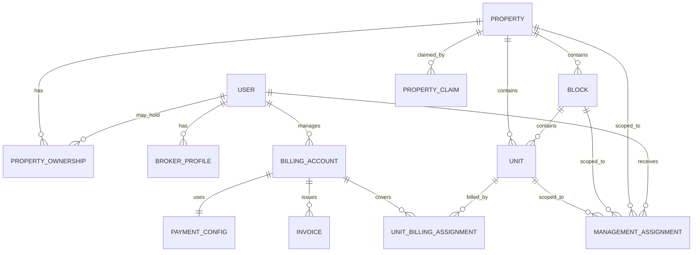
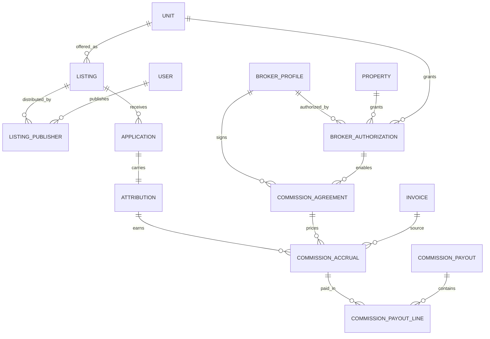

# Stage 1 — Target Domain Model

**Status:** Draft for approval  
**Date:** 2026-11-01  
**Depends on:** `multi-admin-revamp-01-architecture-audit.md`,
`multi-admin-revamp-02-gap-analysis.md`

> Logical design only. Field names are proposals, not committed production
> schemas. All timestamps are UTC, all money is stored in integer minor units
> unless a legacy field is explicitly called out.

---

## 1. Design principles

1. **Physical inventory is independent of management.** A property, block and
   unit exist once and can be managed by different admins over time.
2. **Authority is explicit, scoped and revocable.** Every staff action resolves
   to an active `ManagementAssignment`; no authority is inferred from a
   property's creator.
3. **Ownership is not authority.** Legal ownership and management are separate
   records. An owner may appoint an admin; an admin does not become an owner.
4. **Billing responsibility is explicit.** Every unit has one active billing
   account for a given period, independent of who manages it.
5. **Marketplace inventory is unit-centric.** A listing represents one rentable
   unit. Multiple authorised publishers can distribute the same canonical
   listing.
6. **Attribution is immutable once earned.** Broker sourcing is captured at
   acquisition, confirmed at tenancy, and never silently overwritten.
7. **Commission is a ledger, not a split.** Commission accrual is independent of
   rent settlement and is reversed explicitly.
8. **Legacy compatibility is a first-class state.** Old `ownerId` fields remain
   readable during migration and are removed only after cutover.
9. **No silent deletion.** Privileged records use status transitions and audit
   events; physical deletion is limited to disposable drafts.
10. **Occupancy stays unit-authoritative.** `Lease.unitId` remains the source of
    truth; `Unit.tenantId[]` remains a reconciled cache.

---

## 2. Bounded contexts

```text
┌────────────────────┐      ┌──────────────────────┐
│ Property Inventory │◄────►│ Management & Access  │
│ Property/Block/Unit│      │ Assignment, Policy   │
└─────────┬──────────┘      └──────────┬───────────┘
          │                            │
          ▼                            ▼
┌────────────────────┐      ┌──────────────────────┐
│ Tenancy & Billing  │      │ Marketplace & Broker │
│ Lease/Invoice/Pay  │      │ Listing/Attribution  │
└─────────┬──────────┘      └──────────┬───────────┘
          │                            │
          └──────────────┬─────────────┘
                         ▼
              ┌──────────────────────┐
              │ Commission & Payout  │
              └──────────────────────┘
```

| Context | Owns | Does not own |
| --- | --- | --- |
| Property Inventory | Property identity, blocks, units, structure | Who may manage or bill |
| Management & Access | Assignments, scopes, permissions, policy decisions, audit | Legal ownership, money |
| Ownership | Legal interests and payout entitlement | Dashboard access |
| Tenancy & Billing | Tenant membership, leases, invoices, payments, fee plans | Broker rewards |
| Marketplace & Broker | Listings, publishers, broker profiles, authorisations, attribution | Rent settlement |
| Commission | Agreements, accruals, payouts, reversals | Invoice status |

---

## 3. Property inventory

### 3.1 `Property`

Canonical physical property. **No `ownerId` and no management fields.**

| Field | Type | Notes |
| --- | --- | --- |
| `_id` | ObjectId | Stable canonical id |
| `code` | string | Human-readable public reference, unique among active properties |
| `title` | string | Display name, not unique |
| `type` | string | `PropertyType.key` |
| `purpose` | string | `residential`, `commercial`, `mixed`, `land` |
| `location` | string | Display address |
| `county` | string | Canonical Kenyan county |
| `city` / `town` | string | Optional |
| `street` / `estate` | string | Optional |
| `plotNumber` | string (`(town,plotNumber)`) | Optional but preferred identity |
| `geocode` | GeoJSON Point | Optional |
| `normalisedAddressKey` | string | Lowercase, punctuation-stripped address hash |
| `lifecycleState` | enum | `draft`, `active`, `archived`, `merged` |
| `verificationStatus` | enum | `unverified`, `pending`, `verified`, `rejected` |
| `mergedIntoPropertyId` | string | Set only when `lifecycleState = merged` |
| `createdByUserId` | string | Audit only, not authority |
| `createdAt` / `updatedAt` | Date | |

Indexes:

- unique `{ code }` among non-deleted rows;
- unique `{ plotNumber, city }` when both are non-empty;
- unique `{ normalisedAddressKey }` where non-empty **only if** product accepts
  strict dedupe; otherwise non-unique search index;
- `{ county, city, type, lifecycleState }`;
- `{ geocode: "2dsphere" }` when present.

`lifecycleState` describes the physical record, **not** availability. Public
availability moves to `Listing`. The legacy `status` field
(`available|occupied|maintenance`) and `published` flag remain read-only during
the compatibility window.

### 3.2 Property identity and duplicate handling

Property creation has three paths:

1. **New property.** An admin supplies identity fields and structure; the record
   starts as `lifecycleState = draft` and becomes `active` after verification (manual or
   automatic).
2. **Claim existing property.** If the normalised identity matches an existing
   record, the admin files a `PropertyClaim` instead of creating a duplicate.
3. **System-admin merge.** Duplicates are merged into a canonical property;
   `mergedIntoPropertyId` is set, and children/blocks/units/assignments are
   moved by an audited migration, never by renaming ids.

`PropertyClaim` is defined in §11.

### 3.3 Address normalisation

A deterministic `normalisedAddressKey` is generated from county, city/estate,
street, plot number and title tokens. It is a dedupe **signal**, not a hard
constraint by default: two legitimate properties can share an address (for
example, different blocks or units). The implementation must allow a claim
override with a reason and audit event.

---

## 4. Management authority

### 4.1 `ManagementAssignment`

The single source of staff authority.

| Field | Type | Notes |
| --- | --- | --- |
| `_id` | ObjectId | |
| `principalUserId` | string | User receiving authority |
| `accessRole` | enum | `admin`, `custodian`, `caretaker` |
| `scopeType` | enum | `property`, `block`, `unit` |
| `propertyId` | string | Required |
| `blockId` | string | Required when `scopeType = block` or `unit` |
| `unitId` | string | Required when `scopeType = unit` |
| `permissions` | string[] | Explicit subset of the role's allowed actions |
| `status` | enum | `pending`, `active`, `suspended`, `revoked`, `expired` |
| `startsAt` / `endsAt` | Date | `endsAt` optional |
| `grantedByUserId` | string | |
| `grantedAt` | Date | |
| `revokedByUserId` / `revokedAt` | string/Date | |
| `reason` | string | Required for revoke/suspend |
| `source` | enum | `invitation`, `claim`, `migration`, `system` |
| `legacyOwnerId` | string | Migration trace only |

Indexes:

- unique active assignment per `{ principalUserId, accessRole, scopeType,
  propertyId, blockId, unitId }` among `status = active`;
- `{ principalUserId, status, startsAt, endsAt }`;
- `{ propertyId, scopeType, status }`;
- `{ blockId, status }`;
- `{ unitId, status }`.

Rules:

- `system-admin` does not need an assignment.
- An `admin` at property scope implicitly covers all blocks/units in that
  property, subject to the explicit permission list.
- A `custodian` or `caretaker` can be assigned at property, block or unit scope.
  Unit scope is the narrowest and does not imply sibling units.
- The property creator receives an `admin` assignment in the same atomic
  operation that creates the property, or an explicit grant from an existing
  admin.
- Assignments are time-bounded where applicable. Expired/revoked assignments do
  not grant access, even if the user still has a role.
- Permissions are explicit; a role grants a **maximum** set, not an implicit
  full set. Migration may grant all currently allowed actions to preserve
  behaviour.

### 4.2 Roles

Target role enum:

```text
tenant | caretaker | custodian | admin | broker | system-admin
```

`owner` is retired as a platform role. It maps to `admin` during migration.
Legal ownership is represented by `PropertyOwnership` and does not grant
dashboard access by itself.

| Role | Authority source | Default surface |
| --- | --- | --- |
| `admin` | Active `ManagementAssignment` at property/block/unit | Admin portfolio dashboard |
| `custodian` | Active assignment, narrower permissions | Custodian dashboard |
| `caretaker` | Active assignment, operational permissions | Caretaker dashboard |
| `broker` | Active `BrokerProfile` + `BrokerAuthorization` | Broker dashboard |
| `tenant` | Own tenancy/identity | Tenant dashboard |
| `system-admin` | Global | Platform console |

### 4.3 Permission model

The proposed action taxonomy remains close to the current one to reduce
migration risk, but every action is evaluated as:

```text
allow if:
  actor is active system-admin
  OR actor has active assignment whose scope contains the resource
     AND action ∈ assignment.permissions
     AND action ∈ roleMaximum(actor.role)
     AND resource is not archived/merged
```

Resource containment:

- property action → assignment scope must be that property;
- block action → property or block scope, and block belongs to property;
- unit action → property, block or unit scope, and unit belongs to block;
- lease/invoice/payment/application/move-request/document/complaint/chat →
  resolve their unit (or property); authority is the unit's effective
  management scope, plus role-specific constraints.

The full matrix is in `multi-admin-revamp-04-authorization.md`.

### 4.4 Ownership records

`PropertyOwnership` represents legal/economic interests.

| Field | Type | Notes |
| --- | --- | --- |
| `propertyId` | string | |
| `holderType` | enum | `user`, `external` |
| `holderUserId` | string | Required for `user`; must not be assumed to be admin |
| `legalName` | string | Required for external or co-owner |
| `shareBps` | integer | 1–10,000; sum per property should equal 10,000 |
| `isPrimaryPayee` | boolean | At most one active primary payee |
| `effectiveFrom` / `effectiveTo` | Date | |
| `status` | enum | `active`, `ended`, `disputed` |
| `evidenceDocumentId` | string | Optional |
| `createdByUserId` | string | |
| `legacyOwnerId` | string | Migration trace |

Rules:

- Ownership records do not grant dashboard access.
- An admin can also be an owner, but that is represented by two records.
- Rent payee is resolved from the unit's `BillingAccount`, not automatically
  from ownership. The billing account must name its legal entitlement.
- Co-owner share changes require audit and do not rewrite historical invoices.

---

## 5. Physical structure and units

### 5.1 `Block`

A separate collection so multiple admins can safely add blocks to one property.

| Field | Type | Notes |
| --- | --- | --- |
| `propertyId` | string | Required |
| `name` | string | Display; unique among live blocks in property |
| `code` | string | Optional stable code |
| `order` | integer | |
| `purpose` | string | Optional |
| `rentOverride` | decimal/null | Optional |
| `floors` | embedded[] | `{ _id, level, label, unitsPerFloor, rentOverride, purpose }` |
| `status` | enum | `active`, `inactive` |
| `createdByUserId` | string | |
| `legacyPropertyBlockId` | string | Embedded block id from migration |

Indexes:

- unique `{ propertyId, name }` among live rows;
- `{ propertyId, order }`;
- `{ legacyPropertyBlockId }` during compatibility.

### 5.2 `Unit`

The rentable record and occupancy subject.

| Field | Type | Notes |
| --- | --- | --- |
| `propertyId` | string | Required |
| `blockId` | string | Required |
| `floorId` | string | Embedded floor id |
| `name` / `code` | string | Unique per block among live rows |
| `status` | enum | `available`, `occupied`, `reserved`, `maintenance` |
| `purpose` | string | |
| `rent` | decimal | Base rent |
| `serviceCharge` | decimal | Legacy fallback |
| `rentIncludesServiceCharge` | boolean | |
| `rentSharePercent` / `serviceChargeSharePercent` | integer | 0–100 |
| `beds` / `baths` / `area` | number | |
| `floorLevel` | integer | Denormalised for queries |
| `tenantId` | string[] | Occupant `User._id` cache; reconciled from leases |
| `occupancyVersion` | integer | Optimistic-concurrency guard |
| `billingAccountId` | string | **Denormalised current active assignment, indexed** |
| `createdByUserId` | string | |
| `legacyOwnerId` | string | Compatibility only |
| `legacyBlockId` / `legacyFloorId` | string | Migration trace |

Indexes:

- unique `{ blockId, name }` among live rows;
- unique `{ propertyId, code }` when code is present;
- `{ propertyId, status }`;
- `{ billingAccountId, status }`;
- `{ blockId, floorLevel }`;
- `{ tenantId }` (multikey, operational lookups).

Rules:

- `Lease.unitId` is authoritative occupancy. `Unit.tenantId` and
  `Unit.status` are updated only by `lib/allocation.ts`.
- `reserved` is not currently a production state. If introduced, it must have
  an owner, expiry and release path and must not block allocation without an
  explicit hold.
- The current one-active-lease-per-tenant policy remains in the first release.
  True multi-unit tenancy is a separate change (see open questions).

### 5.3 Structure ownership

`PropertyStructure` operations are authorised against `property:structure:edit`
on the property scope. Block/unit creation by an admin with block/unit
assignment is allowed only within that scope. The service layer must ensure
the `propertyId`/`blockId`/`floorId` tuple is consistent.

---

## 6. Tenancy

`Tenant`, `Application`, `MoveRequest`, `Lead`, and `Lease` retain their core
semantics with these changes:

| Entity | Change |
| --- | --- |
| `Tenant` | Remove dependence on `ownerId` for access. Keep `propertyId`; optional `userId`. Add `sourceAttributionId` for acquired tenants. |
| `Application` | Add `listingId`, `publisherUserId`, `brokerUserId`, `attributionId`, `requestedUnitId`; property is derived from listing/unit. |
| `MoveRequest` | Resolve authority from unit/property assignment, not `ownerId`. |
| `Lead` | Admin-scope, not owner-scope; add listing/publisher/attribution refs. |
| `Lease` | Add `billingAccountId` and `unitId` (already exists); retain tenant/property. No commission fields. |

`Tenant` remains a property membership record, not a global identity. Global
identity continues to be `User`. Tenant uniqueness remains per property contact
during the first release; cross-property identity consolidation is out of scope.

---

## 7. Billing and financial responsibility

### 7.1 `BillingAccount`

The payee/issuer for one or more units.

| Field | Type | Notes |
| --- | --- | --- |
| `_id` | ObjectId | |
| `ownerAdminId` | string | Admin responsible for billing operations |
| `legalEntityName` | string | Name printed on invoices |
| `legalOwnerRef` | string | Optional link to `PropertyOwnership` |
| `invoicePrefix` | string | Unique; e.g. `INV`, `INV2`; new format `${prefix}-${YYYYMM}-${seq}` |
| `invoiceCounters` | object | Period → integer, atomic |
| `defaultCurrency` | string | `KES` |
| `paymentConfigId` | string | Provider config |
| `status` | enum | `active`, `suspended`, `closed` |
| `legacyOwnerId` | string | Migration trace |

`BillingAccount` replaces the billing role of `User`/`ownerId`. It owns invoice
numbering and payment credentials. It is **not** an access role: holding it does
not grant property access.

### 7.2 `UnitBillingAssignment`

| Field | Type | Notes |
| --- | --- | --- |
| `unitId` | string | |
| `billingAccountId` | string | |
| `effectiveFrom` / `effectiveTo` | Date | |
| `status` | enum | `active`, `scheduled`, `ended`, `disputed` |
| `assignedByUserId` | string | |
| `reason` | string | |
| `legacyOwnerId` | string | |

Indexes:

- unique active assignment per `{ unitId }`;
- `{ billingAccountId, status }`;
- history index `{ unitId, effectiveFrom }`.

Rules:

- Every unit must have exactly one active billing assignment before it can be
  listed or invoiced.
- Historical invoices keep a snapshot of the billing account, legal entity,
  invoice prefix and fee lines. Reassigning billing does not rewrite them.
- A unit transfer is scheduled, not immediate. In-flight invoices remain with
  the old account.
- `Unit.billingAccountId` is a denormalised current pointer maintained by the
  assignment service and validated by an invariant job.

### 7.3 `PaymentConfig`

Target shape of `OwnerPaymentConfig`, keyed by `billingAccountId`.

| Field | Notes |
| --- | --- |
| `billingAccountId` | unique |
| `provider` | `daraja` (primary), extensible |
| `shortcode`, `consumerKey`, `consumerSecret`, `passkey` | encrypted at rest |
| `callbackPathKey` | opaque routing key, not a secret |
| `environment` | `sandbox`, `production` |
| `status` | `active`, `disabled` |
| `legacyOwnerId` | migration trace |

The callback URL becomes
`/api/v1/payments/mpesa/callback/[billingAccountId]/[token]`. The legacy
`[ownerId]` route remains as an adapter during the compatibility window.

### 7.4 Fees and invoices

| Entity | Target scope |
| --- | --- |
| `ServiceFeeItem` | `billingAccountId`, `propertyId`, applies-to unit ids or purpose |
| `UnitServiceFeeOverride` | `billingAccountId`, `propertyId`, `itemId`, `unitId` |
| `Invoice` | `billingAccountId`, `billingAdminId` (snapshot), `unitId` (required for generated lease invoices, optional for manual property-level invoices), `leaseId`, `tenantId`, `propertyId`; keep `legacyOwnerId` |
| `Payment` | `billingAccountId`, `invoiceId`, `unitId`, `tenantId`, `propertyId`; keep `legacyOwnerId` |
| `PaymentSplit` | unchanged; rent vs service charge only |

Invoice snapshot fields must include:

- billing account id and legal entity name;
- invoice prefix/number;
- unit/block/property display labels;
- rent and service-charge lines;
- currency and amounts in major KES;
- attribution/commission references **must not** appear on the tenant invoice.

### 7.5 Commission

Commission is **not** a `PaymentSplit` line. It is accrued after eligible rent
settlement and paid from the billing account's payable balance or platform
clearing, per agreement. See §8.5.

---

## 8. Marketplace, brokers and commission

### 8.1 `Listing`

Canonical unit offer.

| Field | Type | Notes |
| --- | --- | --- |
| `_id` | ObjectId | |
| `propertyId` | string | Denormalised |
| `blockId` | string | Denormalised |
| `unitId` | string | Required |
| `state` | enum | `draft`, `active`, `paused`, `let`, `expired`, `withdrawn` |
| `headline` / `description` | string | |
| `askingRent` | decimal | May differ from `Unit.rent`; snapshot at publish |
| `serviceCharge` | decimal | |
| `depositMonths` | number | |
| `availableFrom` | Date | |
| `minimumStayMonths` | number | |
| `amenities` | string[] | |
| `media` | object[] | UploadThing refs |
| `visibility` | enum | `public`, `unlisted` |
| `canonicalPublisherUserId` | string | Creator/owner of the listing |
| `verifiedByUserId` / `verifiedAt` | string/Date | Moderation |
| `publishedAt` / `expiresAt` | Date | |
| `version` | integer | Optimistic concurrency |
| `createdByUserId` | string | |

Indexes:

- unique `{ unitId }` among `state ∈ {draft, active, paused, let}` (one
  canonical listing per unit);
- `{ state, availableFrom, expiresAt }`;
- `{ propertyId, state }`;
- text index on headline/description if search requires it.

Rules:

- A listing can exist only for a unit whose `status` is `available` or
  `reserved`, and only when the unit has an active billing assignment.
- Publishing requires `listing:publish` on the unit scope, or an active broker
  authorisation plus agreement.
- Occupied units cannot remain `active`; allocation moves them to `let` and
  records the attribution.
- Rent changes after publication are **not** silently reflected. The publisher
  must republish/update the listing, producing an audit event.

### 8.2 `ListingPublisher`

Authorised distribution of a canonical listing.

| Field | Type | Notes |
| --- | --- | --- |
| `listingId` | string | |
| `publisherUserId` | string | Admin or broker |
| `publisherRole` | enum | `admin`, `broker` |
| `brokerAuthorizationId` | string | Required for broker |
| `shareCode` | string | Opaque, unique, used in public links |
| `state` | enum | `active`, `paused`, `revoked`, `expired` |
| `startsAt` / `endsAt` | Date | |
| `createdByUserId` | string | |
| `revokedByUserId` / `revokedAt` | string/Date | |

Indexes:

- unique active `{ listingId, publisherUserId }`;
- unique `{ shareCode }`;
- `{ publisherUserId, state }`.

Multiple publishers can distribute the same listing. They do not create
duplicate physical listings. Each share code carries deterministic attribution.

### 8.3 `BrokerProfile`

| Field | Type | Notes |
| --- | --- | --- |
| `userId` | string | unique |
| `displayName`, `phone`, `email` | string | |
| `agencyName` | string | Optional |
| `licenceNumber` | string | Optional but required if product mandates licensing |
| `specialties` / `counties` | string[] | |
| `status` | enum | `pending`, `verified`, `suspended`, `rejected` |
| `verifiedByUserId` / `verifiedAt` | string/Date | |
| `payoutMethod` | object | Encrypted/limited details |
| `ratingSummary` | object | Optional |

Broker status is checked on every broker action. A `User.role = broker` with no
verified profile cannot access marketplace data or publish.

### 8.4 `BrokerAuthorization`

| Field | Type | Notes |
| --- | --- | --- |
| `brokerUserId` | string | |
| `scopeType` | enum | `property`, `block`, `unit` |
| `propertyId` / `blockId` / `unitId` | string | |
| `status` | enum | `pending`, `active`, `suspended`, `revoked`, `expired` |
| `startsAt` / `endsAt` | Date | |
| `grantedByUserId` | string | Must have `broker:authorize` on scope |
| `grantedAt` | Date | |
| `evidenceDocumentId` | string | Optional |
| `reason` | string | Required for revoke/suspend |

Indexes:

- unique active `{ brokerUserId, scopeType, propertyId, blockId, unitId }`;
- `{ brokerUserId, status }`;
- `{ propertyId, status }`.

A broker authorisation grants **market participation**, not access to tenant
records, invoices or internal notes.

### 8.5 `CommissionAgreement`

| Field | Type | Notes |
| --- | --- | --- |
| `brokerUserId` | string | |
| `scopeType` / `propertyId` / `blockId` / `unitId` | | Must be within broker authorisation |
| `basis` | enum | `first_month_rent`, `percentage_of_collected_rent`, `fixed` |
| `rateBps` | integer | Required for percentage bases |
| `fixedAmountMinor` | integer | Required for fixed |
| `collectionMonths` | integer | Default 1; for percentage basis |
| `payer` | enum | `billing_account`, `property_owner`, `platform` |
| `taxBps` | integer | Withholding applied to gross |
| `currency` | string | `KES` |
| `status` | enum | `draft`, `pending_acceptance`, `active`, `expired`, `terminated` |
| `effectiveFrom` / `effectiveTo` | Date | |
| `acceptedByBrokerAt` | Date | |
| `createdByUserId` / `terminatedByUserId` | string | |
| `documentId` | string | Optional signed agreement |

Rules:

- A listing cannot be published by a broker without an active agreement on the
  listing's unit (or its parent block/property).
- The agreement is snapshotted into each accrual; later rate changes do not
  alter existing accruals.
- Commission is calculated only on **collected rent**, never on service charge,
  deposit, utility reimbursement or penalties, unless a future agreement
  explicitly adds a category.

### 8.6 `Attribution`

Acquisition evidence for a tenancy.

| Field | Type | Notes |
| --- | --- | --- |
| `_id` | ObjectId | |
| `unitId` / `propertyId` | string | |
| `listingId` | string | |
| `publisherUserId` | string | |
| `shareCode` | string | Snapshot from `ListingPublisher` |
| `source` | enum | `broker`, `admin`, `owner`, `platform`, `direct` |
| `brokerUserId` | string | Required when `source = broker` |
| `commissionAgreementId` | string | Required when `source = broker` |
| `prospectUserId` | string | Optional until identity is created |
| `applicationId` | string | Set on application |
| `tenantId` | string | Set on conversion |
| `leaseId` | string | Set on allocation |
| `status` | enum | `provisional`, `locked`, `confirmed`, `rejected`, `expired`, `reversed` |
| `evidence` | object | Landing metadata, timestamps, user agent hash, opt-in |
| `provisionalExpiresAt` | Date | |
| `lockedAt` / `confirmedAt` | Date | |
| `supersededByAttributionId` | string | Correction trail |

Indexes:

- unique `{ applicationId }` where set;
- unique `{ tenantId, leaseId }` where confirmed;
- `{ brokerUserId, status, createdAt }`;
- `{ unitId, status }`;
- TTL/cleanup index only for expired provisional rows (optional; prefer status).

Rules:

- Attribution is captured when a prospect enters through a publisher share code
  or when an admin/broker creates the application on the prospect's behalf.
- Direct walk-ins create a `platform`/`direct` attribution for completeness.
- Once `locked`, only status transitions and append-only evidence may change;
  the source identity is immutable.
- If two brokers claim the same prospect, the earliest valid server-recorded
  landing wins; disputes are resolved by `system-admin` and recorded as a new
  superseding attribution, never by editing history.
- Conversion to tenancy confirms the attribution exactly once.

### 8.7 `CommissionAccrual`

| Field | Type | Notes |
| --- | --- | --- |
| `attributionId` | string | |
| `agreementId` | string | |
| `brokerUserId` | string | |
| `billingAccountId` | string | |
| `invoiceId` | string | Source rent invoice; unique per accrual kind |
| `paymentId` | string | Settled payment |
| `kind` | enum | `initial`, `recurring`, `adjustment`, `clawback` |
| `basisAmountMinor` | integer | Collected rent allocated to this accrual |
| `grossCommissionMinor` | integer | |
| `taxWithheldMinor` | integer | |
| `netCommissionMinor` | integer | |
| `currency` | string | |
| `status` | enum | `pending`, `eligible`, `approved`, `paid`, `reversed` |
| `eligibleAt` | Date | After refund window |
| `payoutId` | string | |
| `reversalOfAccrualId` | string | For clawbacks |
| `createdAt` / `updatedAt` | Date | |

Indexes:

- unique `{ attributionId, invoiceId, kind }`;
- `{ brokerUserId, status, eligibleAt }`;
- `{ payoutId }`;
- `{ agreementId, status }`.

Rules:

- Accrual is created only after the rent portion of the invoice is settled.
- `first_month_rent` creates one `initial` accrual, capped at the first month's
  rent actually collected.
- `percentage_of_collected_rent` creates at most one accrual per invoice period
  within `collectionMonths`.
- A refund/cancellation within the eligibility window creates a `clawback`,
  not a mutation of the original accrual.
- Reversal never deletes the original row.
- Commission is payable only when `eligible`, never on `pending`.

### 8.8 `CommissionPayout`

| Field | Type | Notes |
| --- | --- | --- |
| `brokerUserId` | string | |
| `periodStart` / `periodEnd` | Date | |
| `accrualIds` | string[] | Frozen set |
| `grossMinor` / `taxMinor` / `netMinor` | integer | |
| `status` | enum | `draft`, `approved`, `processing`, `paid`, `failed`, `cancelled` |
| `method` / `reference` | string | Provider/payment reference |
| `approvedByUserId` | string | |
| `paidAt` | Date | |
| `notes` | string | |

Indexes:

- `{ brokerUserId, status, periodEnd }`;
- unique `{ reference }` when paid.

Payout cannot include an accrual from another currency or a non-eligible
accrual. A failed payout releases the accruals back to `approved`.

---

## 9. Supporting entities

### 9.1 `PropertyClaim`

| Field | Notes |
| --- | --- |
| `propertyId` | Existing property being claimed |
| `claimantUserId` | Admin |
| `evidence` | Documents/notes |
| `status` | `pending`, `approved`, `rejected`, `withdrawn` |
| `reviewedByUserId` / `reviewedAt` | |
| `decisionNote` | |

An approved claim grants a `ManagementAssignment`, not ownership.

### 9.2 `AuditEvent`

Append-only:

| Field | Notes |
| --- | --- |
| `actorUserId` / `actorRole` | |
| `action` | e.g. `assignment.grant`, `listing.publish`, `commission.payout` |
| `entityType` / `entityId` | |
| `scope` | property/block/unit ids |
| `before` / `after` | Redacted JSON; no secrets or full PII |
| `requestId` / `ipHash` / `userAgentHash` | |
| `createdAt` | TTL not applied in first release |

Audit writes are part of the same service operation as the change where
possible; if a transaction is unavailable, an outbox/retry mechanism is
required. Audit failure must not silently drop a privileged change.

### 9.3 Documents and notifications

- `PropertyDocument` gains `scopeType`/`scopeId`, `visibility`
  (`staff`, `tenant`, `broker`, `public`), and optional `leaseId`.
- Document access is resolved through assignment scope plus visibility, not a
  hard-coded owner branch.
- `Notification` recipients are resolved from active assignments. New recipient
  types: `admin`, `billing-admin`, `broker`, `system-admin`.
- Broker notifications must never include tenant contact details until the
  tenant has consented or the tenancy is confirmed.

---

## 10. Relationship diagrams

### 10.1 Inventory and authority



### 10.2 Marketplace and commission



`COMMISSION_PAYOUT_LINE` may be an embedded snapshot in `CommissionPayout`;
the logical relationship is shown for clarity.

---

## 11. State machines

### 11.1 Management assignment

```text
pending ──accept/start──► active ──expire──► expired
   │                       │
   └──cancel───────────────┼──revoke──► revoked
                           └──suspend──► suspended ──resume──► active
```

### 11.2 Listing

```text
draft ──publish──► active ──pause──► paused ──resume──► active
  │                  │  │
  │                  │  ├──let (allocation)──► let
  │                  │  └──expiry──► expired
  └──withdraw────────┴────────────────────► withdrawn
```

### 11.3 Broker profile and authorisation

```text
profile: pending ──verify──► verified ──suspend──► suspended ──reinstate──► verified
             └──reject──► rejected

authorization: pending ──activate──► active ──expire──► expired
                    │                  │
                    └──cancel──────────┼──revoke──► revoked
                                       └──suspend──► suspended
```

### 11.4 Attribution

```text
provisional ──application──► provisional (linked)
     │                           │
     ├──expiry──────────────────►expired
     ├──reject──────────────────►rejected
     └──tenancy confirm─────────►locked ──dispute/refund──►reversed
                                   │
                                   └──finalise──►confirmed
```

### 11.5 Commission

```text
pending ──eligibility window──► eligible ──approve──► approved ──payout started──► paid
   │                                │                    │
   └──cancel──► reversed            └──hold──► pending   └──payout fail──► approved
                                                            └──refund──► reversed
```

---

## 12. End-to-end domain flows

### 12.1 Property creation/claim

1. Admin searches canonical identity to avoid duplicates.
2. If no match, create `Property` (`lifecycleState = draft`) + `Block`s + `Unit`s + creator
   `ManagementAssignment`; assign billing account(s).
3. If match, submit `PropertyClaim`; a reviewer grants an assignment.
4. Verification marks `lifecycleState = active`; no owner field is set.
5. Every step writes `AuditEvent`.

### 12.2 Admin delegation

1. Admin with `assignment:grant` on a scope invites another admin/custodian/
   caretaker.
2. A pending assignment is created; acceptance verifies identity and starts
   the assignment.
3. The assignment carries only permissions allowed by the role maximum and
   the grantor's own permissions (no privilege escalation).
4. Revocation is immediate for new requests; active sessions re-resolve
   authority per request.

### 12.3 Listing and acquisition

1. Admin publishes a unit listing; an active billing assignment is required.
2. Broker with active authorisation + agreement attaches a `ListingPublisher`
   and receives a share code.
3. Prospect opens the share link; the server records a `provisional`
   `Attribution` with listing/publisher/broker snapshots.
4. Prospect applies; `Application` references the listing and attribution.
5. On approval/allocation, attribution locks and confirms against
   `Tenant`/`Lease`; the listing becomes `let`.
6. If no tenancy occurs by expiry, the attribution expires without commission.

### 12.4 Billing and commission

1. `UnitBillingAssignment` resolves the invoice issuer. Invoice stores billing
   snapshots.
2. Tenant pays through the billing account's provider config.
3. Settlement marks the invoice paid and records `PaymentSplit`.
4. The commission service detects the confirmed attribution and creates an
   idempotent accrual for eligible collected rent.
5. After the refund/eligibility window, accrual becomes `eligible`; an admin
   approves a payout; payout marks accruals `paid`.
6. Refund/cancellation triggers explicit `clawback`/`reversed` rows.

---

## 13. Legacy compatibility fields

During the migration window only:

- `Property.ownerId` → readable legacy field; target model ignores it.
- `Property.status` (`available|occupied|maintenance`) and `published` →
  legacy availability fields; target uses `lifecycleState` + `Listing`.
- `Property.caretakerIds[]` / `custodianIds[]` → migrated to assignments.
- `Unit.ownerId` → migrated to `UnitBillingAssignment`/legacy.
- `Invoice.ownerId`, `Payment.ownerId`, `PaymentSplit.ownerId`,
  `ServiceFeeItem.ownerId`, `UnitServiceFeeOverride.ownerId`,
  `OwnerPaymentConfig.ownerId` → migrated to billing account references, with
  `legacyOwnerId` retained.
- `User.managedByOwnerId`, `User.privileges` → migrated to assignments; legacy
  values retained read-only until the final cutover.
- `User.role = "owner"` → `admin` with a legacy flag on the audit event.

No legacy field is deleted in the first production release.

---

## 14. Model invariants

1. A `Property` has no single owning user field.
2. Every non-system staff request resolves at least one active
   `ManagementAssignment` whose scope contains the resource.
3. Legal ownership never grants access; an assignment never changes ownership.
4. Exactly one active `UnitBillingAssignment` exists for a unit at any instant.
5. A listing requires an available/reserved unit and an active billing
   assignment.
6. One canonical listing per unit; multiple publishers attach to it.
7. At most one confirmed attribution per tenancy; attribution history is
   append-only.
8. Commission can accrue only from confirmed attribution and settled rent.
9. Commission never applies to service charge, deposit or penalties by default.
10. Occupancy writes remain exclusively in `lib/allocation.ts`.
11. Invoice snapshots never change after issue.
12. Every privileged mutation writes an audit event or a durable outbox record.
13. Soft-deleted/archived properties, blocks and units cannot be listed or
    newly assigned.
14. Published listing terms are immutable per version; edits create an audit
    event and require republication.

---

## 15. Deliberate exclusions from the first release

- Global tenant identity and cross-property tenant merge.
- Multiple simultaneous active leases per tenant.
- Co-broker splits and sub-broker networks.
- Broker marketplace ratings/reviews.
- Public owner/landlord accounts.
- Automated legal-ownership verification.
- Multi-currency.
- Tax invoicing beyond a single withholding rate on commission.
- General ledger/accounting export.

These require product decisions and are recorded in
`multi-admin-revamp-08-open-questions-risks.md`.
