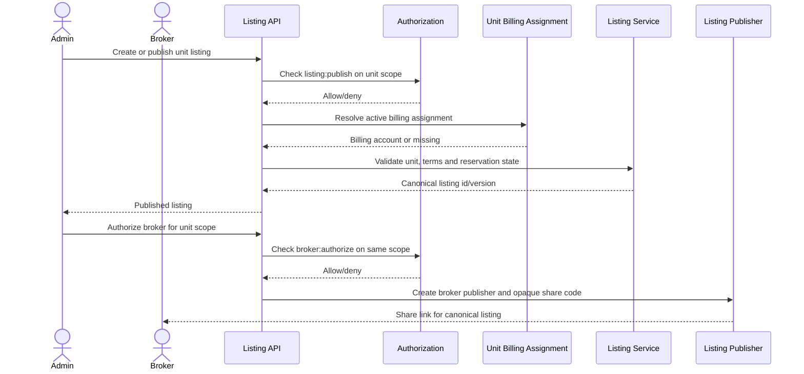

# Stage 1 — Marketplace, Broker and Commission Design

**Status:** Approved target design; marketplace phases not yet authorized
**Date:** 2026-11-01; decision reconciliation: 2026-11-02
**Depends on:** `multi-admin-revamp-03-domain-model.md`,
`multi-admin-revamp-04-authorization.md`

> The approved decisions in `multi-admin-revamp-09-approval.md` supersede open
> product questions in this draft. Legal/Finance confirmations remain required
> before real payouts.

---

## 1. Product intent

A unit can be offered by the admin responsible for it and, where authorised, by
one or more brokers. The public marketplace must show accurate unit-level
availability, allow brokers to distribute listings with traceable share links,
and pay commission only when a tracked prospect becomes a paying tenant.

The design must answer four questions for every tenancy:

1. **What was offered?** The canonical unit and listing version.
2. **Who published it?** The admin/broker and their authority.
3. **Who sourced the tenant?** The confirmed attribution.
4. **What is owed?** The commission agreement and accrual ledger.

---

## 2. Current versus target

| Concern | Current | Target |
| --- | --- | --- |
| Listing unit | Property | Unit |
| Availability | `Property.status = available` + `published` | `Listing.state = active` for an available unit; reservation is a separate record |
| Publisher | None | `ListingPublisher` (admin/broker) |
| Public unit data | Legacy `includeUnits=all` path allowed broad unit results; current handler limits unauthenticated responses to available units | New listing projection remains unimplemented; keep occupied/private data excluded |
| Application source | Property/unit only | Listing + publisher + attribution |
| Broker identity | None | Verified `BrokerProfile` |
| Broker authority | None | Scoped `BrokerAuthorization` |
| Reward | None | Agreement + accrual + payout |
| Audit | None | Every state change audited |

## 2.1 Sequence diagrams

### Listing publication and publisher authorization



### Inquiry, application, tenancy and shadow commission

```mermaid
sequenceDiagram
  actor Prospect
  actor Admin
  participant Public as Public Listing API
  participant Attribution as Attribution Service
  participant Application as Application Service
  participant Allocation as Allocation Service
  participant Lease as Lease Store
  participant Payment as Payment Settlement
  participant Commission as Commission Shadow Service

  Prospect->>Public: Open listing with publisher share code
  Public->>Attribution: Validate active publisher and record provisional touch
  Attribution-->>Public: Short-lived attribution context
  Prospect->>Application: Submit application
  Application->>Attribution: Resolve last valid touch (30-day window)
  Attribution-->>Application: Lock attribution on submission
  Application-->>Admin: Pending application and locked attribution
  Admin->>Allocation: Approve and allocate requested unit
  Allocation->>Lease: Create active Lease with unitId
  Lease-->>Allocation: Lease persisted
  Allocation-->>Admin: Unit allocated; listing channels suspended
  Prospect->>Payment: Make first rent payment
  Payment->>Payment: Settle payment idempotently
  Payment->>Attribution: Confirm against active lease and payment
  Payment->>Commission: Emit settled-rent event
  Commission->>Commission: Calculate idempotent shadow accrual
  Commission-->>Admin: Reconciliation report; no payout
```

These sequences show design intent only. Actual payout remains disabled until
Legal/Finance confirms the decisions in approval 09 §4.6.

---

## 3. Listing model

### 3.1 One canonical listing per unit

A listing is the canonical offer for a unit. Multiple publishers attach to it;
they do not create duplicate listings. This keeps public inventory
de-duplicated and makes attribution deterministic.

```text
Unit
 └── Listing (one active canonical listing)
      ├── ListingPublisher — admin share code
      ├── ListingPublisher — broker A share code
      └── ListingPublisher — broker B share code
```

A unit may have historical listings for prior tenancies. The unique constraint
applies only to live states (`draft`, `active`, `paused`, `let`). A tenancy
closes the listing; a later vacancy creates a new listing version.

### 3.2 Listing fields

The listing captures the offer, not the entire unit record:

- property/block/unit ids;
- headline, description, amenities, media;
- asking rent and service charge;
- deposit months and minimum stay;
- available-from date;
- visibility (`public`/`unlisted`);
- publisher terms/version;
- state, published/expiry dates;
- verification metadata;
- created/updated by.

Rent is a listing snapshot. Changing `Unit.rent` does not silently change a live
listing; the publisher must revise it, which increments the listing version and
writes an audit event.

### 3.3 Publishing eligibility

A listing may become `active` only when:

1. the unit exists and is not archived/merged;
2. `Unit.status` is `available`; any reservation is represented separately and
  checked without adding `reserved` to `Unit.status` in the first release;
3. the unit has an active `UnitBillingAssignment`;
4. the publisher has `listing:publish` on the unit scope, or is a broker with
   verified profile + active `BrokerAuthorization` + active agreement;
5. the property is `active` and not disputed for the relevant scope;
6. the listing has at least one valid rent term and available-from date;
7. media/description meet moderation requirements.

If any condition fails at publish time, return `422` with field-level reasons.

### 3.4 Lifecycle

```text
draft ──publish──► active ──pause──► paused ──resume──► active
  │                  │  │
  │                  │  ├──allocation──► let
  │                  │  └──expiry──────► expired
  └──withdraw────────┴─────────────────► withdrawn
```

| Transition | Trigger | Side effects |
| --- | --- | --- |
| `draft → active` | Publisher publishes | Validate eligibility; set published/expiry; audit; notify favourites? |
| `active → paused` | Admin/publisher | Removed from public results; existing provisional attributions remain valid until expiry |
| `active → let` | Allocation succeeds | Close publishers; public page shows "let"; no new inquiries |
| `active → expired` | Scheduler | Removed from public results; publishers notified |
| `active/paused → withdrawn` | Admin/system-admin | Removed; publishers revoked; audit |
| `let → draft` | New vacancy, explicit re-list | New listing version; do not reuse old attribution |

Expiry default: 60 days, configurable. A listing can be renewed, producing an
audit event but not a new canonical id unless terms materially change.

### 3.5 Vacancy and re-listing

When a unit is vacated:

- if a listing exists in `let`, keep it for history;
- create a new listing draft for the new availability period;
- copy media/terms only after an explicit "relist" action;
- do not reuse prior share codes or attribution.

When a unit is allocated, `Listing.state` moves to `let`; all
`ListingPublisher.state` rows move to `expired`/`revoked`. A broker cannot
continue collecting leads for a let unit.

### 3.6 Favourites and notifications

Current unit-favourite notifications fire on `available` transition. Under the
new model:

- notify only when a listing is published/activated, not merely when the unit
  cache changes;
- notify once per listing version;
- do not notify for `unlisted` listings;
- batch/dedupe notifications by user and listing.

---

## 4. Publishers

### 4.1 Publisher roles

| Publisher | Requirements | Public identity |
| --- | --- | --- |
| Admin | Active assignment + `listing:publish` | Optional; may show agency/manager name |
| Broker | Verified profile + active authorisation + active agreement | Broker/agency name, licence if verified |
| System-admin | Emergency/quality only | Platform label |

### 4.2 Share codes

Each publisher gets an opaque `shareCode` embedded in public links:

```text
/properties/<listing-slug>?ref=<shareCode>
```

The share code:

- is validated server-side on listing open/inquiry;
- resolves to a publisher and listing;
- is rate-limited and expires with the publisher/listing;
- never contains user ids, unit ids or commission terms;
- is safe to include in analytics and notifications.

### 4.3 Multiple publishers

- All publishers use the same canonical listing terms.
- If the product wants different broker pricing, that must be a separate
  listing variant decision, not an untracked price override.
- A broker cannot add another publisher.
- An admin can revoke a broker publisher independently of the broker's
  property-level authorisation; revocation affects only distribution.
- If an exclusive agreement is enabled, publishing by other brokers is blocked;
  admin direct publishing follows the same scope policy. Exclusivity is off in
  the first release (approval plan M-06); enabling it later requires a separate
  decision.

### 4.4 Publisher performance

Publisher-level metrics:

- views (aggregate, not individual tracking);
- inquiries;
- applications;
- confirmed tenancies;
- commission accrued/paid;
- average time to let.

Brokers see their own metrics only. Admins see publishers on their units.
System-admin sees aggregate platform metrics.

---

## 5. Broker onboarding and verification

### 5.1 Application flow

1. A user signs up with intended role `broker` (or applies from an existing
   account).
2. They submit `BrokerProfile`: name, contact, agency, licence, counties,
   specialties, payout method.
3. Profile starts `pending`. The user can only edit the profile or withdraw.
4. System-admin reviews evidence and marks `verified`/`rejected`.
5. Verification writes an audit event and notifies the broker.
6. A suspended broker retains history but cannot access marketplace data or
   publish.

### 5.2 Verification evidence

At minimum:

- government-issued identity or business registration;
- estate agency licence where required by product policy;
- payout account ownership;
- conflict-of-interest declaration;
- acceptance of platform broker terms.

Product/legal must confirm whether a licence is mandatory. If not verified, the
profile remains `pending` and no public broker badge is shown.

### 5.3 Broker dashboard

- profile/verification status;
- authorisations by property/unit;
- listings they can distribute;
- share links and performance;
- own prospects/applications (redacted);
- commission accruals/payouts;
- disputes.

---

## 6. Broker authorisation and agreements

### 6.1 Authorization

An admin with `broker:authorize` can authorise a verified broker for:

- a property (all units),
- a block,
- a specific unit.

The authorization carries an effective period and can be suspended/revoked.
A broker cannot self-authorise or expand scope.

Approved: any admin with `broker:authorize` on that unit scope may authorise;
no additional co-admin consent is required by default. Record the granting
admin and scope in the audit trail (approval plan M-05/M-07).

### 6.2 Agreement

Before publishing, the broker must have an active commission agreement on the
same scope. The agreement defines:

- basis: first-month rent, percentage of collected rent, or fixed;
- rate/fixed amount;
- collection period for recurring rent;
- payer: billing account pays the broker directly; the platform records and
  reconciles the obligation but does not hold or route funds (approval plan
  B-12; Legal/Finance confirmation is still required);
- tax withholding rate;
- effective dates;
- accepted-by-broker timestamp;
- signed document reference.

The agreement is snapshotted into each accrual so later renegotiation does not
rewrite history.

### 6.3 Exclusivity

Exclusivity is **off by default** in the first release. If enabled later:

- only one active broker publisher per scope;
- admin direct publishing rules must be explicit;
- exclusive agreements need a separate acceptance/termination flow;
- existing publishers are not silently revoked; they are ended with notice.

---

## 7. Acquisition attribution

### 7.1 Why it must be server-side

Attribution is a financial claim. It cannot be trusted from a hidden form field,
local storage, or a client-controlled `brokerId`. The server must validate:

- the share code exists and is active;
- the publisher is authorised for the listing;
- the broker agreement is active;
- the listing/unit are eligible.

### 7.2 Capture

Recommended default:

1. A visitor opens a share link. The server resolves `ref` to a live
   `ListingPublisher` and records a short-lived, signed visitor attribution
   token (or includes the share code in the inquiry form server-side).
2. On inquiry/application, the server creates a `provisional` `Attribution`
   with the listing, publisher, broker, agreement and evidence.
3. For an authenticated user, the most recent valid publisher touch within the
   attribution window is stored on the user's session/attribution record.
4. A direct application creates a `platform`/`direct` attribution.
5. Lock attribution when the application is submitted. Confirm it only after
  an active lease and the first successful payment; do not wait until
  allocation to lock it (approval plan B-04/B-06).

### 7.3 Conflict rules

Approved default rules (approval plan §4.3–4.4):

| Scenario | Result |
| --- | --- |
| Broker A link, then broker B link, then apply | Last valid touch wins within 30 days |
| Broker A link, user applies without a new touch | Broker A wins until window expiry |
| Broker A application exists | Later broker link cannot overwrite it |
| Admin creates application on behalf of a broker's prospect | Admin selects the broker share code; if none, direct |
| Two brokers claim the same prospect | Earliest valid server-recorded application wins; disputes via system-admin |
| Prospect is already a tenant elsewhere | No new commission unless the product defines expansion commission |
| Applicant rejects / never signs | Provisional expires; no commission |
| Tenancy confirmed then cancelled within refund window | Confirmed attribution reversed; accrual clawback |

Attribution history is append-only. A correction creates a new superseding
record with a reason; it never mutates the original broker/publisher fields.

### 7.4 Attribution window

Default: 90 days provisional; 30-day last-touch window. Both configurable.
Do not use indefinite cookies. Document retention and consent in the privacy
policy.

### 7.5 Duplicate prevention

- At most one `provisional` attribution per application.
- At most one `confirmed` attribution per tenancy/lease.
- Unique indexes enforce this.
- If a second confirmation is attempted, return a conflict and require an
  explicit dispute/resolution.

---

## 8. Commission

### 8.1 Principles

1. Commission is earned from **collected rent**, not from invoice issuance.
2. Service charge, deposit, penalties, utilities and taxes are excluded by
   default.
3. Commission is a ledger with accrual, eligibility, approval, payout and
   reversal states.
4. It is separate from `PaymentSplit`.
5. Rates are snapshotted; history is immutable.
6. The broker cannot approve or pay their own commission.

### 8.2 Calculation

All amounts in integer minor units (KES cents). Define one rounding function
and use it everywhere.

```text
basisMinor =
  first_month_rent:        min(collectedRentMinor, oneMonthRentMinor)
  percentage_of_rent:      collectedRentMinor for each eligible invoice
  fixed:                   0 (fixed amount is used directly)

grossMinor =
  first_month_rent:        round(basisMinor * rateBps / 10000)
  percentage_of_rent:      round(basisMinor * rateBps / 10000)
  fixed:                   fixedAmountMinor

taxMinor = round(grossMinor * taxBps / 10000)
netMinor = grossMinor - taxMinor
```

- The supported agreement terms are fixed and/or percentage-based (approval
  plan B-11). If `first_month_rent` is selected, its default rate and any cap
  remain unresolved under D-04; do not assume `rateBps = 10000` or a 100% cap
  is approved.
- Rounding is half-up at the final minor-unit step; intermediate values use
  integer math.
- Negative or zero basis creates no accrual.
- A future partial-payment model must accrue proportionally to collected rent,
  never to the full invoice.

### 8.3 Eligibility

1. Payment settles and the rent portion is known.
2. Accrual is created as `pending` with a unique key
   `{ attributionId, invoiceId, kind }`.
3. After `eligibilityDelayDays` (default 7), the accrual becomes `eligible`.
4. An admin with `commission:approve` reviews and approves within the agreement
   limits.
5. System-admin executes payout; broker cannot self-approve.
6. Payout marks accruals `paid` and stores the provider reference.

For `first_month_rent`, only the first settled rent invoice can create the
`initial` accrual. Duplicate callback/replay must not create a second accrual.

For `percentage_of_collected_rent`, each settled invoice within
`collectionMonths` creates one `recurring` accrual with the agreement snapshot.

### 8.4 Refunds and clawbacks

- Refund/cancellation within the clawback window (default 30 days) creates a
  `clawback` accrual for the paid amount.
- If the accrual is not yet paid, it moves to `reversed`.
- If already paid, the clawback is netted against the next payout; if no future
  payout exists, it becomes a receivable.
- Never edit or delete the original accrual.
- Disputed tenancy pauses eligibility; system-admin resolves.

### 8.5 Payer and fund flow

This is a material product/legal decision:

| Model | Description | Consequence |
| --- | --- | --- |
| Billing account pays | Admin's account pays broker directly | Platform records only |
| Platform clearing pays | Platform receives rent/commission clearing and pays broker | Requires platform ledger, reconciliation and possibly licensing review |
| Owner pays | Legal owner pays separately | Billing account is not the payer |

Platform-clearing and separate legal-owner payment are not first-release flows;
reconsider only under a new product/legal decision.

Approved design direction: **billing account pays directly**; the platform
records and reconciles but does not route the funds. Legal/Finance must confirm
the payer and workflow before payout functionality is enabled.

### 8.6 Payouts

- Monthly cycle, configurable cut-off.
- Minimum payout threshold, configurable.
- Payout batch freezes `accrualIds`.
- Failed payout returns accruals to `approved`, not `pending`.
- Paid payout is immutable except for a recorded reversal.
- Broker sees gross, tax, net and payment reference, not other brokers' data.

### 8.7 Disputes

Disputes can be raised by broker, admin or billing owner. System-admin resolves
with evidence. Resolution creates a new audit event and, if needed, a
superseding attribution or adjustment accrual. Time limits and escalation are
open decisions.

---

## 9. Public marketplace

### 9.1 Public listing list

`GET /api/v1/marketplace/listings`

Supported filters:

- county/city/estate;
- property type;
- unit purpose;
- rent range (unit listing rent);
- bedrooms/bathrooms;
- amenities;
- available-from;
- verified-only;
- publisher type (admin/broker);
- sort: newest, rent, available date.

Never return:

- tenant names/contacts;
- occupied unit details;
- internal notes;
- owner/admin contact details beyond a public contact channel;
- commission or agreement data;
- exact unit door number if the privacy decision hides it.

### 9.2 Public listing detail

`GET /api/v1/marketplace/listings/[idOrSlug]?ref=<shareCode>`

Return:

- listing terms and media;
- public property identity (county, estate, approximate location);
- unit type/bedrooms/baths/area;
- availability date;
- publisher public identity;
- inquiry CTA.

Exact address/unit number should be released only after an inquiry is accepted
or the product explicitly chooses public addresses. This is a decision (see
open questions).

### 9.3 Inquiry/application

- Public inquiry creates a lead with listing, publisher and share code.
- If the visitor already has an account, it creates an application or links the
  lead.
- Server validates the share code and records attribution.
- Duplicate inquiry/application per listing/user is prevented.
- Turnstile/rate limiting and spam controls apply.

### 9.4 Public API caching

- Cache public listing lists/details at the edge with short TTLs.
- Purge on publish/pause/let/withdraw.
- Do not cache personalised/attribution responses in a shared cache.
- Public projections must be serialiser-based, not ad hoc field omission.

---

## 10. Security and abuse

- Public endpoints: rate limits by IP and share code; bot protection.
- Share codes: rate-limited, revocable, no PII.
- Broker data: no tenant PII before conversion/consent.
- Listing media: moderated, size/type validated, no EXIF leakage.
- Duplicate listings: canonical unit listing plus physical identity checks.
- Fraud: same broker repeatedly claiming unrelated prospects triggers review.
- Commission: segregation of duties (broker ≠ approver ≠ payer).
- Audit: every authorisation, agreement, attribution and payout state change.
- Privacy: retention policy for provisional attributions and visitor evidence.

---

## 11. Notifications

| Event | Recipients |
| --- | --- |
| Listing published/expired/let | Publisher(s), admin |
| New inquiry/application | Publisher responsible for attribution, admin |
| Publisher authorised/revoked | Broker, admin |
| Broker verified/suspended | Broker, system-admin |
| Agreement pending/active/terminated | Broker, admin |
| Attribution locked/confirmed/disputed | Broker, admin, system-admin |
| Commission eligible/approved/paid/reversed | Broker, billing admin, system-admin |
| Payout failed | Broker, system-admin |

Notifications must use the new assignment-derived recipients, not
`ownerId`/`caretakerIds`.

---

## 12. Proposed API surface

Public:

```text
GET  /api/v1/marketplace/listings
GET  /api/v1/marketplace/listings/[idOrSlug]
POST /api/v1/marketplace/listings/[idOrSlug]/inquiries
GET  /api/v1/marketplace/locations
```

Admin:

```text
GET/POST   /api/v1/listings
GET/PATCH  /api/v1/listings/[id]
POST       /api/v1/listings/[id]/publish
POST       /api/v1/listings/[id]/pause
POST       /api/v1/listings/[id]/resume
POST       /api/v1/listings/[id]/withdraw
POST       /api/v1/listings/[id]/publishers
DELETE     /api/v1/listings/[id]/publishers/[publisherId]
POST       /api/v1/broker-authorizations
PATCH      /api/v1/broker-authorizations/[id]
POST       /api/v1/commission-agreements
PATCH      /api/v1/commission-agreements/[id]
GET        /api/v1/commissions
POST       /api/v1/commissions/[id]/approve
```

Broker:

```text
POST  /api/v1/brokers/apply
GET   /api/v1/brokers/me
PATCH /api/v1/brokers/me
GET   /api/v1/broker/authorizations
GET   /api/v1/broker/listings
GET   /api/v1/broker/leads
GET   /api/v1/broker/commissions
POST  /api/v1/broker/agreements/[id]/accept
```

System-admin:

```text
POST /api/v1/system/brokers/[id]/verify
POST /api/v1/system/brokers/[id]/suspend
POST /api/v1/system/attributions/[id]/resolve
POST /api/v1/system/commission-payouts
POST /api/v1/system/commission-payouts/[id]/pay
GET  /api/v1/system/audit-events
```

Route names are proposals; the existing `/api/v1` conventions (auth helpers,
same-origin, rate limit, `{ data }` / `{ error }`) apply.

---

## 13. UX surfaces

### 13.1 Admin

- Unit detail: "List this unit", listing state, publishers, share links.
- Listings board: draft/active/paused/let/expired, filters by property.
- Broker authorisations: scope, expiry, agreement status.
- Commission: accruals, approvals, payouts, disputes.
- Property unit grid: listing badge and availability.
- Billing account and fee plan settings.

### 13.2 Broker

- Onboarding/verification.
- Authorised properties/units.
- Create publisher link (if allowed; otherwise request authorisation).
- Share links and performance.
- Prospects/applications with redaction.
- Commission statement/payouts.
- Agreement acceptance/renewal.

### 13.3 Public

- Unit-level listing cards with rent, type, available date, publisher.
- Listing detail with gallery, terms, location privacy, inquiry.
- Share-code-aware links.
- No occupied-unit or tenant data.

### 13.4 System-admin

- Broker verification queue.
- Attribution disputes.
- Commission payout batch and reconciliation.
- Audit search.
- Property duplicate/merge queue.

---

## 14. Testing

### 14.1 Domain

- One live listing per unit; historical listings allowed.
- Publish rejects occupied unit, missing billing assignment, missing
  authorisation and expired agreement.
- Allocation moves listing to `let` and closes publishers atomically/with
  compensation.
- Vacancy requires explicit relist; share codes are not reused.
- Multiple publishers share canonical terms and have distinct share codes.
- Publisher revocation blocks new attribution but preserves existing locked
  attribution per policy.

### 14.2 Attribution

- Valid share code creates provisional attribution.
- Invalid/expired/revoked code is rejected.
- Last-touch rules, duplicate application, and confirmed uniqueness.
- Attribution is immutable after lock.
- Dispute creates superseding record, not mutation.

### 14.3 Commission

- First-month, percentage and fixed calculations, including rounding.
- No accrual on unpaid invoice or service charge.
- Duplicate settlement callback does not duplicate accrual.
- Eligibility delay, approval, payout, reversal/clawback.
- Segregation of duties: broker cannot approve/pay; admin cannot pay.
- Currency/threshold validation.

### 14.4 Security/privacy

- Public endpoints never return tenant/occupied/internal data.
- Broker cannot read unauthorised property/tenant data.
- Admin with unit scope cannot authorise a broker for the whole property.
- Public share code cannot be used to enumerate ids.
- Rate limits and bot protection.

### 14.5 E2E

- Admin creates property/units, lists a unit, authorises broker, agrees
  commission.
- Broker shares link, prospect applies, admin approves, tenant pays, commission
  accrues, system-admin pays.
- Broker revoked mid-flight; no new attribution, existing history preserved.
- Tenant cancels within clawback window; accrual reversed.

---

## 15. Rollout and compatibility

1. Ship unit-level listing read model while legacy property listings still
   exist; public pages use a feature flag.
2. Backfill listings from published available properties/units only after
   confirming unit availability. Do not list occupied units.
3. Add publisher/attribution capture after listings are stable.
4. Enable broker onboarding/authorisation with feature flags per environment.
5. Enable commission accrual in shadow mode first: compute and compare against a
   report, without paying.
6. Enable approvals/payouts last, after finance/legal sign-off.
7. Keep legacy property-level APIs as adapters during the compatibility
   window; remove after all public pages and clients use listings.

---

## 16. Approved decisions and external confirmations

The decisions formerly listed here are resolved by
`multi-admin-revamp-09-approval.md`: approximate public location (M-09),
30-day last-touch locked at application submission (B-04), 90-day provisional
attribution (B-05), non-exclusive publishing (M-06), independent scoped
admins (M-07), direct billing-account payer as the design direction (B-12), no
renewal commission (B-10), and soft duplicate detection with system-admin
review (P-03).

The agreed direction does not replace external confirmation. Legal/Finance must
still confirm the commission basis/rate, payer workflow, tax treatment,
eligibility/clawback values, payout thresholds/cycle and retention policy.
